# GitHub × AI Automation Lab

Construí una landing, publicá dos versiones y conectá GitHub con un runner, un agente y una revisión solicitada por webhook. El ejemplo es el HackerSpace de Nodo Serrano. En cada ejercicio se explica cómo trasladarlo a tu proyecto.

**Recorrido recomendado: tu equipo y containers.** Los seis ejercicios se siguen desde el host, usando Docker cuando aparece en el ejercicio 2. Codespaces queda como demo opcional de la landing; no está validado de punta a punta para runner, Hermes, Telegram, túnel y reviews. No es el plan alternativo para completar la clase.

| Ejercicio | Resultado que vas a comprobar |
| --- | --- |
| [1. Proyecto y deploy](#1-proyecto-y-deploy) | Production desde `main`, Preview desde `development` y un PR integrado |
| [2. Docker y runner](#2-docker-y-runner) | Un check pasa, falla por un error deliberado y vuelve a pasar |
| [3. Hermes y Telegram](#3-hermes-y-telegram) | Una conversación desde la terminal y otra desde Telegram |
| [4. El túnel](#4-el-túnel) | La misma respuesta local se puede consultar por una URL HTTPS pública |
| [5. El webhook](#5-el-webhook) | GitHub envía un evento firmado y el receptor responde |
| [6. La review](#6-la-review) | Una etiqueta solicita una revisión y la respuesta aparece en el PR |

Las capturas son interfaces reales publicadas en la documentación de sus proveedores; usan repositorios de referencia. Los bloques **Ejemplo de salida** son orientativos. Compará los datos de tu propia ejecución: una URL o un mensaje de ejemplo no prueban que tu integración esté funcionando.

## Cómo leer los comandos

Usá Bash en Linux, macOS o [WSL2](https://learn.microsoft.com/en-us/windows/wsl/install). En Windows con Docker Desktop, abrí el proyecto dentro de WSL2. No copies estos bloques directamente a PowerShell.

- `TU_USUARIO/REPO`: reemplazalo por el propietario y nombre de **tu** repositorio.
- `NUMERO`: número real del PR; no lleva `#` en los comandos.
- `RUN_ID`: identificador que devuelve `gh run list`.
- `TU_URL_PUBLICA`: hostname real que imprime cloudflared; no agregues `https://` dos veces.
- Una línea que termina en `\` continúa en la siguiente. Podés pegar el bloque completo.
- Las líneas que empiezan con `#` son comentarios.
- El texto bajo `text` muestra una salida o una tarea para el agente; no es un comando de Bash.

Las etiquetas **host**, **lab-agent** y **lab-app** indican dónde ejecutar cada comando. En el recorrido recomendado, **host** es tu equipo o WSL2; las otras dos etiquetas son containers que crearemos más adelante. La demo opcional de Codespaces usa su terminal remota sólo para el alcance indicado.

Cuando un proceso ocupa la terminal, abrí otra terminal para el siguiente comando. Para detenerlo usá `Ctrl+C` en esa terminal. No hace falta cerrar el entorno.

## 1. Proyecto y deploy

**Objetivo:** publicar la landing primero y aprender branches y PR sobre un cambio visible.

### 1.1 Preparar y publicar tu repo desde el host

Necesitás [Git](https://git-scm.com/install/), [GitHub CLI](https://cli.github.com/) y acceso al repositorio del taller. En una terminal Bash de tu equipo, comprobá `gh auth status`; si falta una sesión válida, usá `gh auth login`. Estos pasos no se hacen dentro de Codespaces y todavía no requieren Node ni Docker.

```bash
git clone https://github.com/theredguild/github-ai-automation-lab.git
cd github-ai-automation-lab
```

Copiá el contenido del starter a una carpeta **inicial** nueva, al lado del material:

```bash
mkdir ../nodoserrano-hackerspace-inicial \
  && cp -R hackerspace-site/. ../nodoserrano-hackerspace-inicial/ \
  && cd ../nodoserrano-hackerspace-inicial
```

Si el destino ya existe, detenete y elegí otro nombre. `hackerspace-site/.` incluye archivos ocultos; `hackerspace-site/*` no los incluye. La `.git` del material queda fuera de la copia: no hace falta borrarla ni copiarla. Guía y presentación también quedan en el checkout del material.

Si ya tenés un sitio propio con archivos generados versionados, no lo reemplaces ni hagas otro `git init`: usá [la reparación de seguimiento](#si-tu-repo-ya-incluye-archivos-generados).

Iniciá el historial de esta copia nueva y comprobá la identidad Git:

```bash
git init -b main
git config user.name
git config user.email
```

Si falta algún valor o corresponde a otra persona, configurá sólo este repo con tus datos reales:

```bash
git config user.name "Tu nombre"
git config user.email "TU_EMAIL"
```

La sesión de GitHub y la identidad de los commits son cosas distintas. Reemplazá los ejemplos antes de ejecutar esos dos comandos.

#### Revisar `.gitignore` antes del primer commit

El starter incluye [`.gitignore`](../hackerspace-site/.gitignore). Es un archivo de reglas que Git usa para no añadir archivos locales que todavía no sigue: dependencias en `node_modules/`, build y cache en `.next/`, store de pnpm y archivos temporales de TypeScript. También excluye `.env.local`; `.env.example` sí se versiona porque no lleva secretos.

Desde la raíz de tu app, asegurate de conservar ese archivo. Si falta, copialo desde el material; si ya existe, no sobrescribas tus reglas:

```bash
test -f .gitignore \
  || cp ../github-ai-automation-lab/hackerspace-site/.gitignore .gitignore
git check-ignore -v --no-index node_modules/ .next/ .pnpm-store/ \
  .vercel/ tsconfig.tsbuildinfo .env.local
```

Cada ruta del ejemplo debe mostrar la regla que la excluye. Si faltan reglas, completalas con las del starter antes de seguir. `--no-index` permite diagnosticar las reglas incluso si algún archivo ya está seguido.

Prepará el commit y **revisá qué se va a guardar**:

```bash
git add .gitignore
git add .
git ls-files -ci --exclude-standard
git diff --cached --name-status
```

`git ls-files -ci --exclude-standard` debe quedar sin salida. Si lista archivos, Git ya los sigue aunque ahora estén ignorados: corregilo con la sección de reparación antes de hacer commit. En el diff deben aparecer código, configuración, lockfile y `.gitignore`, no dependencias, builds ni secretos.

```bash
git commit -m "Agrega la landing del HackerSpace"
```

#### Publicar antes de clonar el sitio

Elegí **una sola** opción desde este host:

**CLI:** usá la sesión de tu equipo y creá un repo privado nuevo:

```bash
gh auth status
gh repo create TU_USUARIO/REPO --private --source=. --remote=origin --push
```

**Alternativa web:** abrí [New repository](https://github.com/new), elegí tu cuenta y un nombre como `nodoserrano-hackerspace`. Crealo privado y **vacío, sin README, licencia ni `.gitignore`**, para no crear otro historial inicial. En lugar de `gh repo create`, conectá ese repo vacío:

```bash
git remote add origin https://github.com/TU_USUARIO/REPO.git
git push -u origin main
```

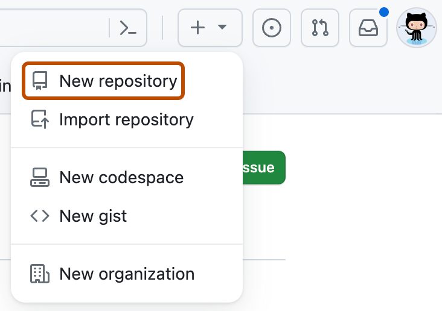

Esperá que el push termine sin error y comprobá en GitHub que estén `package.json`, `app/` y `.gitignore`, sin `.next/` ni `node_modules/`. **Sólo después** pasá a 1.2 para clonar el sitio publicado. Un push fallido no es una publicación terminada.

#### Si tu repo ya incluye archivos generados

Esta reparación se hace en el **repo de tu app en el host**, no en el material del taller. No crea otro repo ni borra archivos de trabajo. Primero ubicá la raíz y revisá el estado:

```bash
git rev-parse --show-toplevel
git status
```

Entrá en esa raíz. Restaurá `.gitignore` sólo si falta, como arriba, y comprobá sus reglas. Para el layout de esta app, quitá del índice sólo las carpetas y el cache conocidos:

```bash
git rm -r --cached --ignore-unmatch node_modules .next .pnpm-store .vercel
git rm --cached --ignore-unmatch tsconfig.tsbuildinfo
```

`--cached` deja esos archivos en tu disco y deja de versionarlos. Si Git rechaza la operación, detenete y revisá el estado; no agregues `-f` ni quites todo el repo del índice.

```bash
git add .gitignore
git ls-files -ci --exclude-standard
git diff --cached --name-status
```

La lista de archivos seguidos e ignorados debe quedar vacía. Si queda alguna ruta anidada, revisala y quitá **esa ruta concreta** del índice. Las entradas `D` de artefactos en el diff son las eliminaciones de seguimiento esperadas; no implican borrarlos del disco. Revisá el resto de tus cambios antes de confirmar y publicar la reparación.

Esto evita seguir versionándolos, pero **no los elimina de commits anteriores**. Si un push fue rechazado por un archivo grande que ya está en el historial, un commit que lo borre no alcanza: detené la publicación y revisá ese historial con el instructor. No hagas force-push ni reescrituras a ciegas. Si se publicó una credencial, revocala o rotala; ignorarla o quitarla del índice no la vuelve segura. [Referencia oficial de `.gitignore`](https://docs.github.com/en/get-started/git-basics/ignoring-files).

### 1.2 Clonar el sitio publicado y trabajar en tu equipo

El recorrido completo usa **tu host + containers**, no Codespaces ni Gitpod. Después del push correcto de 1.1, volvé a la carpeta de proyectos y cloná **tu propio repo** en otra carpeta:

```bash
cd ..
git clone https://github.com/TU_USUARIO/REPO.git nodoserrano-hackerspace
cd nodoserrano-hackerspace
```

El destino debe estar libre. La carpeta `nodoserrano-hackerspace-inicial/` queda como preparación; continuá en este clon nuevo, que trae el historial y `.gitignore` ya publicados. No clones el sitio antes de su primer push correcto.

El clon no trae la configuración local de `.git/config` de la carpeta inicial. Comprobá de nuevo tu identidad, aunque Git permita hacer commits sin preguntar:

```bash
git config user.name
git config user.email
```

Si falta algún valor o corresponde a otra persona, configurá **este clon** con tus datos reales:

```bash
git config user.name "Tu nombre"
git config user.email "TU_EMAIL"
```

Reemplazá ambos ejemplos. Estos comandos sólo cambian este repo; una identidad global incorrecta no se corrige al clonar.

Para el ejercicio 1 prepará [Node 22](https://nodejs.org/en/download), [pnpm 10.20.0](https://pnpm.io/installation) y [GitHub CLI](https://cli.github.com/) en tu equipo. Elegí esas versiones, no otra versión por ser la que aparece primero en una descarga. Todavía no hace falta arrancar Docker.

```bash
node --version
pnpm --version
gh auth status
```

Si la sesión del **host** no es válida, completá `gh auth login` en tu equipo. No copies ni exportes tokens manualmente. En 1.3 ejecutarás `pnpm dev` directamente con Node; Docker aparece en el ejercicio 2.

Las terminales siguientes deben abrirse en la raíz de este clon de la app, con `package.json`, `app/`, `public/` y `Dockerfile` a la vista. Cuando Docker use `$PWD`, debe apuntar a esta raíz, nunca al checkout del material.

#### Demo opcional de la landing en Codespaces, sin garantía del taller completo

Si el instructor quiere mostrar sólo la app desde el navegador, puede abrir [GitHub Codespaces](https://github.com/codespaces) o **Code → Codespaces** en el repo **propio ya publicado**. [Procedimiento oficial](https://docs.github.com/en/codespaces/developing-in-a-codespace/creating-a-codespace-for-a-repository). El enlace puede pedir iniciar sesión en GitHub; no es una URL pública de una app.

Codespaces hace el checkout de ese repo al crearse: no crees otro repo, no clones el material ni clones de nuevo la app dentro de él. La configuración entregada está en `.devcontainer/devcontainer.json`, pero el recorrido completo no está certificado allí. Si faltan herramientas o permisos, no conviertas la clase en una depuración de ese entorno: volvé al host.

No ejecutes `gh auth login` ni `gh auth refresh` para reemplazar la autenticación de Codespaces, y no borres ni exportes sus variables de tokens. Codespaces provee credenciales para su repo, con permisos que pueden no alcanzar para crear repos, administrar hooks o autenticar un agente dentro de otro container. [Autenticación y límites del entorno](https://docs.github.com/en/codespaces/reference/security-in-github-codespaces). Las operaciones que requieran esos permisos se hacen en el host o en la web, no suponiendo que un nuevo login remoto lo soluciona.

Antes de abrir una instancia, revisá [cuota y facturación](https://docs.github.com/en/billing/concepts/product-billing/github-codespaces). La demo se limita a instalar, ejecutar y ver la landing de 1.3; los ejercicios 2–6 continúan en el host.

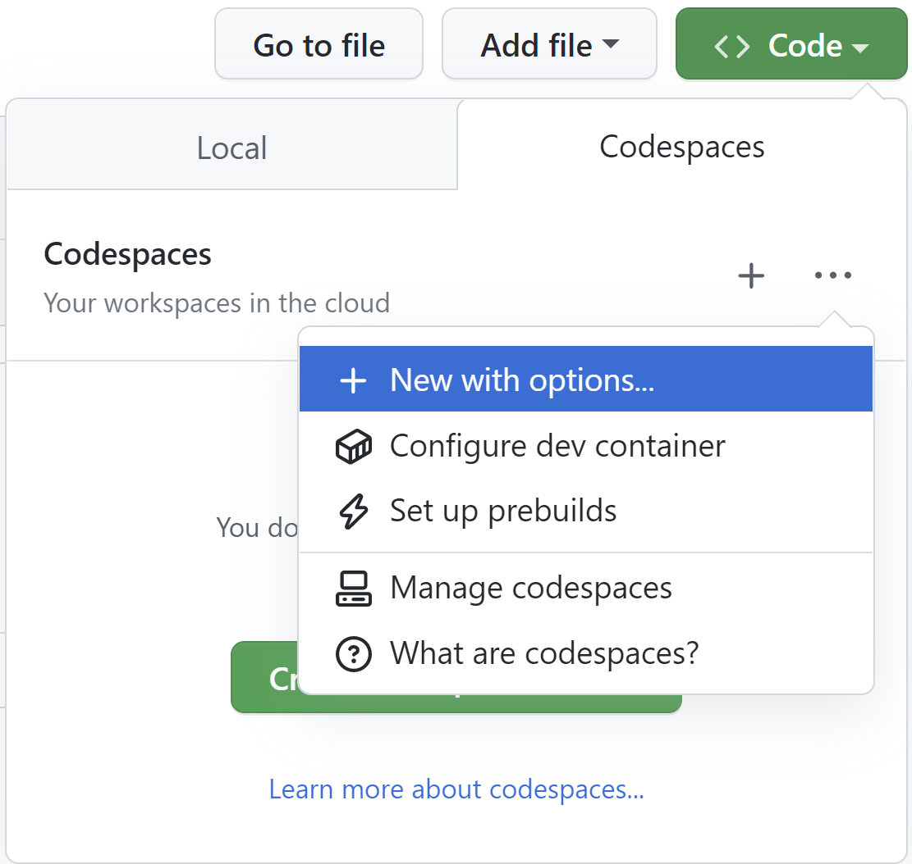

### 1.3 Instalar y ver la landing

```bash
pnpm install --frozen-lockfile
pnpm dev
```

Ejemplo de salida:

```text
Local: http://localhost:3000
Ready in …
```

En tu equipo abrí `http://localhost:3000`. Sólo para la demo opcional de Codespaces, usá **Ports → 3000 → Open in Browser** y conservá el puerto privado. Todavía no es el deployment de Vercel.

Comprobá que se vean el título del HackerSpace, sus actividades y la imagen. Si no carga, volvé a la terminal: el primer error visible suele ser más útil que recargar muchas veces.

| Archivo | Para qué lo usamos |
| --- | --- |
| `app/page.tsx` | Contenido de la landing |
| `app/globals.css` | Estilos |
| `app/estado.ts` | Un número tipado para practicar un error de TypeScript |
| `app/capacidad.ts` | Un cálculo para practicar una review |
| `app/api/health/route.ts` | Respuesta sencilla para observar la red |
| `app/api/github/route.ts` | Receptor preparado para el ejercicio 5 |

Detené el servidor de desarrollo en su terminal y ejecutá:

```bash
pnpm build
```

Un build prepara la aplicación de producción. Una salida exitosa termina sin error y genera los artefactos de Next. Si falla, resolvé el error antes de continuar. Más adelante Vercel hará su propio build a partir del commit de GitHub.

### 1.4 Conectar Vercel

Abrí [Vercel → New Project](https://vercel.com/new), iniciá sesión y elegí **Import Git Repository**. Conectá GitHub y concedé acceso al repo de la práctica. Si no aparece, revisá los permisos de la integración.

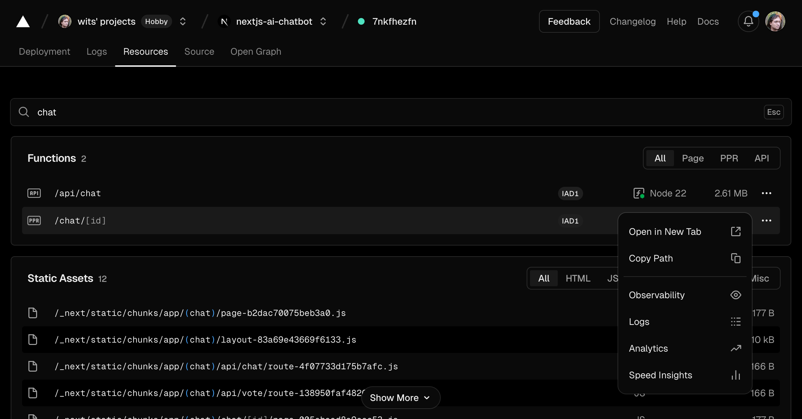

Comprobá la configuración antes de pulsar **Deploy**:

| Campo | Valor de este proyecto |
| --- | --- |
| Framework Preset | Next.js |
| Root Directory | `.`: raíz de tu propio repositorio de la aplicación, no del material del taller |
| Install Command | Dejar la autodetección por `pnpm-lock.yaml`, sin activar Override |
| Build Command | `pnpm build` |
| Node.js | 22.x, en la configuración disponible del proyecto |
| Production Branch | `main` |

No hace falta cargar secretos para publicar esta landing. El receptor de webhooks se usará localmente más adelante; sus secretos no deben terminar en variables `NEXT_PUBLIC_*`.

No sobrescribas Install Command con un `pnpm install` genérico: Vercel puede seleccionar otra versión del gestor. Para fijar exactamente `pnpm@10.20.0` en Vercel, habilitá Corepack según su documentación; no hace falta para el camino básico de autodetección.

Abrí el deployment, leé los **Build Logs** y esperá el estado **Ready**. Visitá su URL de Production. Relacioná el commit mostrado por Vercel con el repo; un sitio que se ve bien puede pertenecer a otro deployment.

**Terminal alternativa para operar un proyecto ya conectado:** la CLI oficial de Vercel permite `vercel login`, `vercel link` y `vercel inspect URL`. Para este ejercicio, la conexión Git se prepara una vez desde la web. Los siguientes deployments los disparará `git push`; no hace falta introducir otro flujo de publicación manual.

### 1.5 Hacer un cambio en development

Guardar un archivo modifica tu copia de trabajo. **Commit** guarda una versión en la historia local. **Push** la envía al repositorio de GitHub. Una branch es una referencia a un commit; un SHA identifica ese commit.

```bash
git switch main
git pull --ff-only
git switch -c development
```

En el editor, buscá el título visible de `app/page.tsx` y cambialo por una frase que reconozcas, por ejemplo, “El HackerSpace de Nodo Serrano”. Guardá y revisá:

```bash
git status
git diff
git add app/page.tsx
git commit -m "Actualiza la portada del HackerSpace"
git push -u origin development
git log -1 --oneline
git rev-parse --short HEAD
```

Si Git pide identidad en esta copia de trabajo, repetí la comprobación y configuración local de 1.2 con tus datos reales. Repetí el commit después.

**Alternativa web:** en GitHub, selector de branches → crear `development` desde `main`; abrí `app/page.tsx`, pulsá el lápiz, editá y confirmá el cambio en `development`. Conservá esta rama para los siguientes ejercicios.

### 1.6 Comparar Preview y Production

Abrí los deployments de Vercel. El push a `development` debe generar un **Preview** asociado a ese commit. Abrilo y buscá tu título nuevo. Luego abrí Production: debe conservar el título anterior hasta integrar el cambio en `main`.

No des por hecho que un push terminó de desplegar. Comprobá el estado, la rama, el SHA y la URL. Si el Preview tiene acceso protegido, usá la sesión autorizada del proyecto; no cambies políticas de acceso sólo para que coincida una captura.

### 1.7 Crear y revisar un pull request

Un PR propone integrar los cambios de una rama en otra. **Compare / head** aporta los cambios; **base** los recibe. En este taller: `development → main`.

**Web:** **Pull requests → New pull request**, elegí **base: main** y **compare: development**. Verificá el diff, escribí título y descripción y pulsá **Create pull request**.

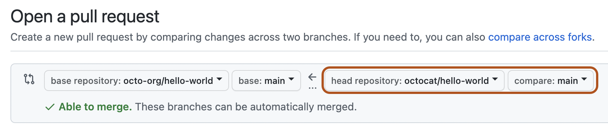

La captura oficial usa otros repositorios y branches. En tu formulario seleccioná los valores de tu ejercicio.

**CLI alternativa:**

```bash
gh pr create --base main --head development \
  --title "Actualiza la portada del HackerSpace" \
  --body "Cambia el titulo visible de la landing."
gh pr list --base main --head development
gh pr view NUMERO
gh pr diff NUMERO
gh pr view NUMERO --web
```

En **Files changed**, verde muestra líneas agregadas y rojo líneas eliminadas. Leé el cambio antes de integrar. En **Review changes** podés comentar, aprobar o pedir cambios según tus permisos. GitHub no permite aprobar tu propio PR; para una práctica individual usá un comentario. Si trabajan de a dos, la otra persona puede hacer la review.

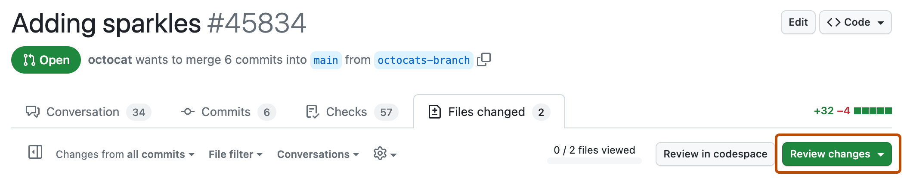

**CLI alternativa para comentar:**

```bash
gh pr review NUMERO --comment \
  --body "Revisé el cambio del título."
```

Sobre el PR de otra persona podés usar `--approve` o `--request-changes` en lugar de `--comment`, con un motivo en `--body`.

### 1.8 Elegir cómo integrar

| Método | Qué agrega a main | Cuándo conviene |
| --- | --- | --- |
| Create a merge commit | Conserva los commits de la rama y agrega un commit con dos padres | Este taller: `development` se reutiliza |
| Squash and merge | Agrupa los cambios del PR en un commit nuevo | Una rama corta que termina después del PR |
| Rebase and merge | Reaplica los commits uno a uno, con SHA nuevos y sin commit de merge | Historia lineal acordada con el equipo |

Estas son alternativas. No ejecutes las tres sobre el mismo PR. En una rama larga, squash puede volver confusas las comparaciones de PR posteriores porque los commits originales siguen en la rama.

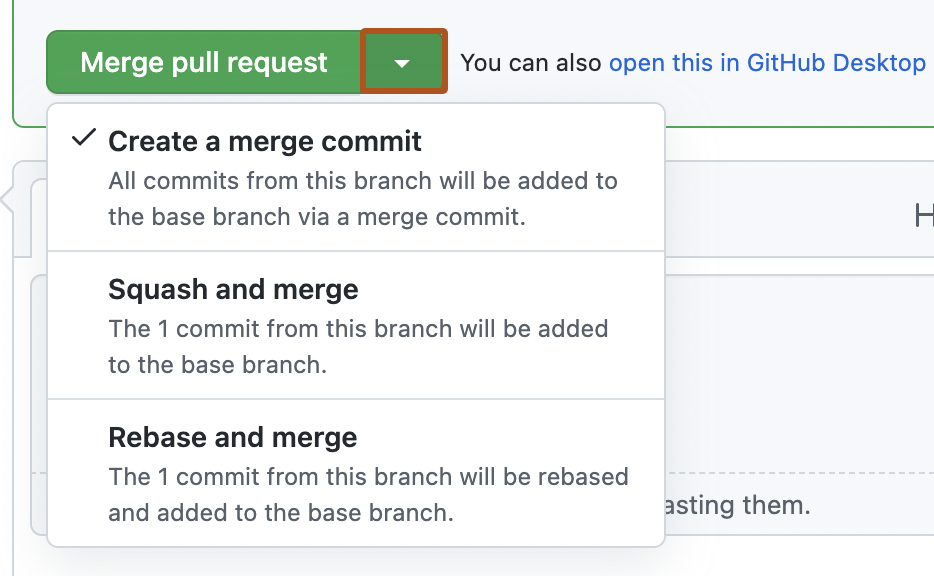

**Web:** en **Conversation**, bajá hasta el botón verde, abrí su flecha, elegí **Create a merge commit** y confirmá. Conservá `development`.

**CLI alternativa:**

```bash
gh pr merge NUMERO --merge
gh pr view NUMERO --json state,mergeCommit
```

Si una regla exige checks o aprobación, atendé ese requisito. No uses bypass. Después del merge, Vercel debe construir un nuevo Production de `main`. Abrí esa URL y comprobá el título nuevo y el SHA del deployment.

**Antes de seguir:** identificá tu repo, el PR integrado, la URL de Production y la de Preview. Si usás otro proyecto, reemplazá sólo framework, comandos y carpeta raíz; Git, branches, PR y la integración Git siguen el mismo recorrido.

## 2. Docker y runner

**Objetivo:** ejecutar un check normal en un entorno propio y reconocer una falla.

### 2.1 Ubicar Host, VM y container

**Host** es la máquina que aloja procesos. Puede ser física o una VM. Una **VM** tiene su propio kernel y se ejecuta sobre un hipervisor. Un **container Linux** aísla procesos y filesystem y comparte el kernel Linux de su host. En Docker Desktop, ese host Linux suele estar dentro de una VM.

El **Dockerfile** es la receta, la **imagen** es el resultado de construirla y un **container** es una instancia en ejecución. Reutilizaremos una imagen de herramientas con instancias separadas para runner, agente y aplicación.

### 2.2 Construir la imagen común

Estos ejercicios continúan en **tu host**, no en Codespaces. Prepará [Docker Desktop o Docker Engine](https://docs.docker.com/get-started/get-docker/) para tu sistema e iniciá su servicio. En la terminal principal, raíz del clon de tu app:

```bash
docker version
docker info
docker build -t workshop-tools:2026-10 \
  --build-arg WORKSHOP_UID="$(id -u)" \
  --build-arg WORKSHOP_GID="$(id -g)" .
docker image ls workshop-tools
docker network create workshop-net
docker network ls
```

`docker version` debe mostrar **Client y Server**. Un error al conectar con el daemon no se arregla reinstalando el cliente. Iniciá Docker Desktop/Engine en tu equipo. Si la red ya existe, reutilizala.

Los argumentos hacen coincidir el usuario `node` de la imagen con tus IDs, sin ejecutar el agente como root. En Linux con Docker Engine convencional, esto permite escribir el bind mount del proyecto. Construí desde una cuenta normal, no con una sesión de usuario root. Si el proyecto pertenece a otra cuenta, prepará sus permisos con el instructor antes de continuar. Docker Desktop y Docker rootless pueden traducir propietarios de otra forma; comprobá escritura en el paso 3.1.

El store de pnpm queda en `/home/node/.local/share/pnpm/store`, fuera del proyecto. Si usás una imagen preparada por otra persona, sus IDs pueden ser distintos: reconstruí con los tuyos antes de crear las instancias que montan el proyecto.

La imagen contiene Bash, Git, Node, pnpm, GitHub CLI, cloudflared, el runner y utilidades mínimas. No guarda sesiones ni registra runners durante el build. Hermes se incorpora durante el setup en vivo del ejercicio 3, siguiendo su documentación oficial.

```bash
docker run --rm -it --name herramientas \
  --network workshop-net \
  workshop-tools:2026-10 bash
```

Ahora estás **dentro del container**. Probá:

```bash
whoami
pwd
node --version
pnpm --version
```

Ejemplo de salida:

```text
node
/workspace
v22.x.x
10.20.0
```

Desde otra terminal del host, `docker exec -it herramientas bash` abre otra shell en esa misma instancia. `docker ps` muestra los containers que siguen ejecutándose. Cuando terminás de explorar, cerrá esas shells; `--rm` elimina esa instancia al finalizar. La imagen sigue disponible.

**Alternativa visual:** Docker Desktop muestra imágenes, containers y logs. El panel no reemplaza la shell del runner ni la consola del agente; para esos procesos usaremos los comandos nativos.

### 2.3 Preparar un workflow sencillo

GitHub Actions organiza el trabajo en **workflow → jobs → steps**. Un runner ejecuta los steps de un job. El check del ejemplo instala el lockfile, corre Biome y revisa tipos de TypeScript.

El archivo está provisto en [`../hackerspace-site/docs/snippets/checks.yml`](../hackerspace-site/docs/snippets/checks.yml) dentro del checkout del material. En tu repo de la aplicación está en `docs/snippets/checks.yml`. Leelo. Todavía no está activado en `.github/workflows/` para que lo incorpores durante el ejercicio.

La parte inicial dice:

```yaml
name: Checks del workshop
on:
  workflow_dispatch:
permissions:
  contents: read
jobs:
  check:
    runs-on: [self-hosted, linux, workshop]
    timeout-minutes: 10
```

`workflow_dispatch` permite iniciarlo a mano. Las etiquetas seleccionan el runner. `contents: read` limita la credencial del job. El checkout está fijado a un commit y no conserva su credencial en Git.

**Para subirlo a main, la web es la opción más directa:** **Add file → Create new file**; nombre `.github/workflows/checks.yml`; pegá el archivo completo y confirmá en `main`. Si el repo exige PR, seguí su procedimiento.

**CLI alternativa:** en lugar de crearlo en la web, ejecutá desde el host:

```bash
git switch main
git pull --ff-only
mkdir -p .github/workflows
cp docs/snippets/checks.yml .github/workflows/checks.yml
git add .github/workflows/checks.yml
git commit -m "Agrega checks manuales"
git push origin main
```

Si GitHub rechaza específicamente la edición de workflows por el alcance de la sesión OAuth de **tu host**, completá allí el consentimiento nativo `gh auth refresh --scopes workflow` y repetí el push. Esto no es una instrucción para Codespaces ni para ampliar su token automático. No hace falta editar tokens ni llamar a la API. Si preferís cambiar al camino web, conservá tu commit local y resolvé la sincronización antes de volver a hacer pull; no crees otra copia del mismo cambio sin revisar `git status`.

Con el workflow ya en `main`, actualizá ambas ramas en tu copia:

```bash
git switch main
git pull --ff-only
git switch development
git merge main
git push origin development
```

Si seguiste la alternativa CLI y ya lo agregaste allí, no vuelvas a crear el mismo archivo desde la web. Revisá `git status` antes de cambiar de rama y guardá cualquier cambio pendiente.

### 2.4 Registrar un runner efímero

En GitHub, **Settings → Actions → Runners → New self-hosted runner**, elegí **Linux** y la arquitectura de tu equipo. Usaremos el runner ya descargado en la imagen; no repitas la instalación que muestra esa pantalla. Buscá el token temporal del comando de **Configure**.

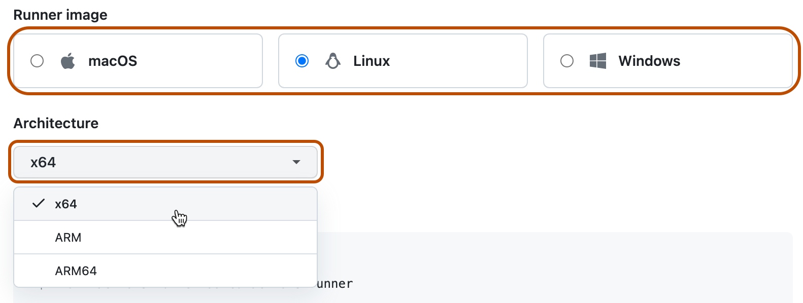

En una terminal nueva del **host**:

```bash
docker run --rm -it --name lab-runner \
  workshop-tools:2026-10 bash
```

Dentro de **lab-runner**, reemplazá el repo y pegá el token temporal cuando lo solicite:

```bash
cd /opt/actions-runner
read -rs -p "Token temporal de registro: " RUNNER_TOKEN
printf '\n'
./config.sh --url https://github.com/TU_USUARIO/REPO \
  --token "$RUNNER_TOKEN" \
  --name workshop-runner --labels workshop --ephemeral
exec ./run.sh
```

`--ephemeral` asigna un solo job y luego da de baja el runner. `exec` reemplaza la shell por ese proceso: cuando termina, el container sale y `--rm` lo elimina. La terminal queda esperando; una línea relevante es **Listening for Jobs**. GitHub debe mostrarlo como disponible. El token de registro es temporal y diferente de tu sesión de `gh`.

Este container no recibe el proyecto del host, el perfil de Hermes, una sesión de GitHub ni el socket Docker. El checkout del job descarga el repo. No se conecta a `workshop-net`: sólo necesita salida hacia GitHub y las descargas del job. Ejecutá únicamente código de la práctica que controles; un runner ejecuta comandos del repositorio.

### 2.5 Ejecutar y observar el check

**Web:** **Actions → Checks del workshop → Run workflow → development → Run workflow**.

**CLI alternativa desde el host:**

```bash
gh workflow run checks.yml --ref development
gh run list --workflow checks.yml --limit 5
gh run watch RUN_ID --exit-status
gh run view RUN_ID --web
```

Abrí cada step del job y buscá instalación, Biome y TypeScript. Si queda **Queued**, revisá que el runner esté escuchando y que sus etiquetas incluyan `self-hosted`, `linux` y `workshop`. Si está en **Failure**, leé el step que falló.

### 2.6 Provocar y corregir un error

En `app/estado.ts`, cambiá deliberadamente:

```typescript
export const plazas: number = 20;
```

por:

```typescript
export const plazas: number = "20";
```

Guardá, revisá el diff, hacé commit y push a `development`. Podés usar el editor web o el local. Este workflow es manual: **el push por sí solo no lo ejecuta**.

Registrá un runner efímero nuevo repitiendo 2.4 con un token vigente. Dispará otro workflow como en 2.5. Buscá una falla de tipos, por ejemplo:

```text
app/estado.ts(1,14): error TS2322:
Type 'string' is not assignable to type 'number'.
```

La misma información se puede consultar con:

```bash
gh run view RUN_ID --log-failed
```

Volvé a `20` sin comillas, hacé commit y push, registrá otro runner y repetí el check. Comprobá que pase sobre el commit corregido. Esto explica por qué “se ve la página” y “pasa el chequeo de tipos” son observaciones distintas.

**En tu proyecto:** reemplazá los comandos por tu linter, typecheck o test habitual. Para incorporar ejecución automática en PR y permitir código de terceros, diseñá antes el aislamiento del runner y sus permisos. La práctica manual y efímera no es una configuración de producción.

## 3. Hermes y Telegram

**Objetivo:** conversar con el agente antes de darle eventos de GitHub.

### 3.1 Crear su instancia

Hermes es el programa que conecta un modelo con herramientas y canales. OpenRouter es un proveedor de acceso a modelos; Telegram será un canal. No son la misma pieza.

En el **host**, raíz del repo:

```bash
docker run -it --name lab-agent \
  --network workshop-net \
  -p 127.0.0.1:8644:8644 \
  -v hermes-home:/home/node/.hermes \
  --mount type=bind,source="$PWD",target=/workspace \
  -w /workspace workshop-tools:2026-10 bash
```

Este container tiene acceso de lectura y escritura a **este proyecto** por el bind mount. Más adelante Hermes podrá preparar su receptor y `.env.local`. No montes tu carpeta personal ni el socket Docker. El volumen `hermes-home` conserva el perfil del agente; no pertenece al runner.

Comprobá permisos dentro de **lab-agent**, antes de configurar credenciales:

```bash
id
test -w /workspace && test -w /home/node/.hermes \
  && echo "Proyecto y perfil escribibles"
```

Si no aparece el mensaje, no continúes con Hermes ni cambies a root: revisá propietario y permisos del proyecto y los IDs usados en el build. Un volumen nuevo hereda el propietario preparado por la imagen; uno existente conserva el suyo.

El nombre debe estar libre. Si ya lo creaste con la misma imagen e IDs, recuperá esa instancia con `docker start -ai lab-agent` o abrí otra shell con `docker exec -it lab-agent bash` si está en ejecución. `docker start` no adopta una imagen reconstruida. Si cambiás los IDs o necesitás reemplazar una instancia que ya guarda credenciales, seguí la migración del [handoff del instructor](INSTRUCTOR.md#migrar-una-instancia-y-su-perfil); no borres el volumen ni descartes el container anterior.

### 3.2 Instalación guiada y wizard

La instalación de Hermes la realiza el instructor en vivo dentro de **lab-agent**, siguiendo la [documentación oficial de inicio](https://hermes-agent.nousresearch.com/docs/getting-started/installation). Si repetís el taller sin instructor, seguí esa página y sus requisitos vigentes, usando el usuario `node`. El Dockerfile no incorpora silenciosamente una instalación distinta. No necesitás estudiar sus herramientas de instalación para el resto del taller.

Con `hermes` disponible:

```bash
hermes setup
```

En el wizard elegí [OpenRouter](https://openrouter.ai/), cargá tu credencial de ese proveedor y seleccioná un modelo gratuito disponible que permita herramientas. Verificá el precio y los límites que muestra tu cuenta en ese momento. No hay un modelo gratuito fijo garantizado. Si no hay uno disponible, podés usar tu proveedor ya configurado, con sus límites y tu consentimiento antes de consumo pago.

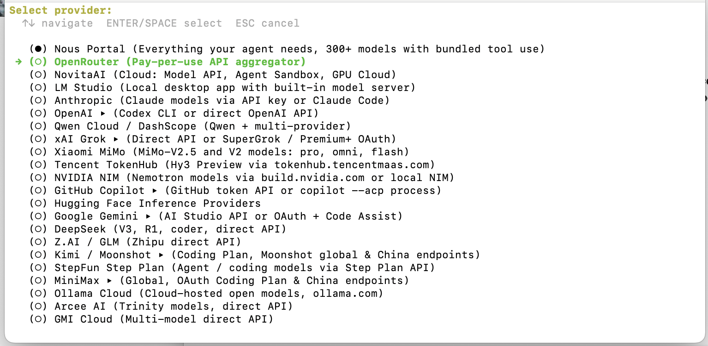

No pegues credenciales en un PR, en Telegram ni en una captura compartida. El wizard las guarda en el perfil del agente. No hace falta exportar tokens de GitHub.

```bash
hermes chat
```

Pedile que se presente en español y que explique qué herramientas tiene disponibles. Una respuesta de chat comprueba esa conversación con el modelo. Todavía no prueba Telegram, GitHub ni los webhooks.

### 3.3 Crear el bot de Telegram

En Telegram abrí el [@BotFather oficial](https://t.me/BotFather), enviá `/newbot`, elegí nombre y username y guardá el bot token de forma privada. Obtené tu **ID numérico de usuario** mediante el procedimiento indicado por la guía de Telegram de Hermes; un `@username` no equivale a ese ID.

En otra shell de **lab-agent**:

```bash
hermes gateway setup
```

Elegí el canal **Telegram**, ingresá el token y configurá la lista de usuarios permitidos con tu ID. Conservá la configuración existente de modelo y proveedor.

```bash
hermes gateway run
```

El gateway es el proceso que mantiene los canales conectados. Dejalo activo. Abrí tu bot desde Telegram, pulsá **Start**, mandá un mensaje y comprobá la respuesta desde tu usuario permitido.

Telegram usa long polling en este recorrido: el gateway consulta la API de Telegram por HTTPS. **No necesitás un túnel para esta conversación.** Si no responde, revisá gateway, token, usuario autorizado, proveedor y logs, en ese orden.

**Alternativas de interfaz:** el alta del bot y los mensajes se hacen en Telegram; la configuración de Hermes se hace con su wizard nativo. No existe un equivalente de `gh` para esas pantallas. En [la documentación de canales](https://hermes-agent.nousresearch.com/docs/user-guide/messaging/telegram) tenés el procedimiento independiente del taller.

## 4. El túnel

**Objetivo:** exponer una respuesta conocida antes de añadir webhooks.

### 4.1 Entender el recorrido mínimo

Un túnel conecta una entrada pública con un servicio que está dentro de tu entorno. **Cloudflare** opera la red pública; **cloudflared** es el proceso local que abre una conexión saliente hacia esa red. No crea tu aplicación ni la reemplaza.

Usaremos un **Quick Tunnel**: genera una dirección temporal `https://…trycloudflare.com`, sin crear cuenta de Cloudflare ni registrar un dominio. Es apropiado para la práctica. No promete una dirección estable ni disponibilidad de producción.

En `https://HOSTNAME/api/health`, `https` es el esquema, `HOSTNAME` es el nombre que se resuelve por DNS y `/api/health` es la ruta que atiende Next. DNS ayuda a localizar la entrada; no decide qué archivo ejecuta el backend.

### 4.2 Levantar la aplicación como origen

Detené cualquier `pnpm dev` que esté usando el puerto 3000 del host. En una terminal nueva del **host**, raíz del proyecto:

```bash
docker run -it --name lab-app \
  --network workshop-net \
  -p 127.0.0.1:3000:3000 \
  --mount type=bind,source="$PWD",target=/workspace \
  -w /workspace workshop-tools:2026-10 bash
```

Dentro de **lab-app**:

```bash
pnpm install --frozen-lockfile
```

Si pnpm detecta un `node_modules` creado antes en el host u otro container, puede pedir permiso para recrearlo con el store actual. En esta terminal interactiva aceptá sólo para el proyecto de la práctica y esperá a que termine. No borres el lockfile ni edites dependencias para resolver esa pregunta. Cada instancia conserva su propio cache del store, fuera del bind mount.

```bash
pnpm build
pnpm start --hostname 0.0.0.0
```

El build debe terminar correctamente antes de `start`. El proceso escucha en las interfaces del container, y `-p 127.0.0.1:3000:3000` publica el puerto sólo en el loopback del host. Un puerto publicado y un túnel son mecanismos distintos.

La ruta provista `app/api/health/route.ts` devuelve:

```typescript
export function GET() {
  return Response.json({ status: "ok", service: "nodoserrano" });
}
```

### 4.3 Consultar por capas

En otra terminal del **host**:

```bash
curl -i http://127.0.0.1:3000/api/health
```

Ejemplo de respuesta:

```text
HTTP/1.1 200 OK
{"status":"ok","service":"nodoserrano"}
```

Ahora desde un container de la misma red:

```bash
docker run --rm --network workshop-net \
  workshop-tools:2026-10 \
  curl -i http://lab-app:3000/api/health
```

Debe devolver el mismo JSON. Docker resuelve `lab-app` dentro de `workshop-net`. **`localhost` siempre vuelve al entorno donde corre el cliente**: dentro de otro container no apunta a `lab-app`.

| Desde dónde preguntás | Dirección del origen |
| --- | --- |
| Host del taller | `http://127.0.0.1:3000` |
| Container conectado a workshop-net | `http://lab-app:3000` |
| Cliente externo, después del túnel | La URL HTTPS que imprime cloudflared |

No continúes a la URL pública si todavía falla la consulta interna.

### 4.4 Abrir el Quick Tunnel

En una terminal del **host**:

```bash
docker run --rm -it --name lab-tunnel \
  --network workshop-net \
  workshop-tools:2026-10 \
  cloudflared tunnel --no-autoupdate \
  --url http://lab-app:3000
```

Buscá en sus logs la dirección real de `trycloudflare.com`. Dejá el proceso activo. Copiá esa dirección y probá:

```bash
curl -i https://TU_URL_PUBLICA/api/health
```

Abrí también esa URL desde el navegador de otro dispositivo, por ejemplo el teléfono. Observá la misma respuesta. La conexión hacia Cloudflare la inició cloudflared desde adentro; la request pública vuelve por esa conexión hasta el origen.

El túnel reenvía el servicio configurado, **no sólo `/api/health`**. La landing y otras rutas de ese servicio quedan alcanzables públicamente. No apuntes el túnel al editor, al daemon de Docker, a una consola de administración ni a un backend con datos privados. HTTPS protege el transporte, no identifica por sí solo quién puede usar la aplicación.

### 4.5 Romper y recuperar la conexión

En otra terminal del host:

```bash
docker stop lab-app
curl -i https://TU_URL_PUBLICA/api/health
```

El túnel puede seguir conectado y aun así fallar el origen; es habitual ver una respuesta **502**. Eso demuestra que “el túnel está arriba” y “la app responde” son comprobaciones diferentes.

Recuperá la instancia:

```bash
docker start -ai lab-app
```

En esa shell, iniciá nuevamente `pnpm start --hostname 0.0.0.0`. Repetí las consultas local, interna y pública. Si recreás el túnel, puede obtener otro hostname: actualizá tus enlaces y, después, los webhooks. La URL anterior no es una dirección reservada.

| Síntoma | Qué revisar primero |
| --- | --- |
| Connection refused local | Proceso Next y publicación del puerto |
| No resuelve lab-app | Containers dentro de la misma red y nombre correcto |
| 502 en la URL pública | Origen, puerto y dirección `--url` |
| 404 | Path y aplicación que recibe la request |
| Nombre público que dejó de responder | Proceso cloudflared y hostname de su arranque actual |

**Opcional para después:** un túnel administrado y un hostname propio requieren la configuración de una cuenta, DNS y políticas de acceso de Cloudflare. La [documentación de túneles](https://developers.cloudflare.com/tunnel/) explica ese camino. No creamos cuenta ni dominio durante este recorrido.

**En otro proyecto:** elegí un endpoint sencillo y un puerto conocidos, probá primero el origen y cambiá `--url`. El concepto no depende de Next.js ni del nombre `lab-app`.

## 5. El webhook

**Objetivo:** recibir un aviso de GitHub sin llamar todavía a un modelo.

### 5.1 Qué cambia respecto del túnel

Consultar periódicamente es *polling*. Un **webhook** invierte esa relación: cuando ocurre un evento, GitHub envía una request HTTP a una URL que configuraste. El túnel sólo transporta esa request; el receptor interpreta el evento y responde.

Usaremos **POST**, JSON, headers con tipo de evento e ID de entrega y una firma HMAC. Un secret compartido permite comprobar que los bytes recibidos coinciden con lo firmado. No se pone en la URL ni en el código cliente.

El receptor ya está en `app/api/github/route.ts`. Su lógica es:

```text
al recibir POST:
  leer bytes con límite de tamaño
  verificar la firma sobre esos bytes
  interpretar JSON y validar el repositorio
  aceptar sólo los eventos permitidos
  detectar una entrega repetida
  registrar metadatos y responder
```

La verificación ocurre **antes** de interpretar JSON. El ejemplo no llama a Hermes ni ejecuta código del PR. La deduplicación vive en memoria una hora, con un máximo de 1000 IDs, y se pierde al reiniciar. No es una cola durable ni una protección completa contra replay.

### 5.2 Preparar la sesión de GitHub del agente

En el host abrí una shell en **lab-agent**:

```bash
docker exec -it lab-agent bash
cd /workspace
gh auth status
```

Si no tiene sesión válida, ejecutá **dentro de lab-agent en Docker de tu host** `gh auth login` y completá el flujo del navegador. Esto no se ejecuta en la terminal de Codespaces. Tu login del host no se comparte automáticamente con el container. Revisá qué cuenta y permisos autorizás: este flujo puede conceder más acceso que un único repositorio. El taller no lo presenta como un token de acceso mínimo a un solo repo.

Con `hermes chat`, podés delegar las tareas repetitivas. Usá tu repo y tu URL reales; no pegues secretos en el mensaje.

### 5.3 Preparar el receptor con Hermes

Tarea para Hermes, dentro de la sesión CLI:

```text
Revisá app/api/github/route.ts de este proyecto.
Adaptalo sólo si hace falta para este backend.
Usá TU_USUARIO/REPO como repositorio permitido.
Prepará .env.local sin imprimir ni versionar secretos.
Generá un secret aleatorio de al menos 32 bytes con crypto u openssl.
Configurá WEBHOOK_SECRET y GITHUB_WEBHOOK_REPO.
Conservá las validaciones y no actives ninguna llamada a IA.
Mostrame un resumen sin credenciales y cómo comprobarlo.
```

El bind mount permite que escriba `.env.local` en el proyecto que también usa `lab-app`. El agente no tiene el socket Docker y no puede reiniciar los otros containers. No le concedas ese acceso para evitar un paso humano.

**Alternativa manual:** copiá `.env.example` a `.env.local`, generá un valor con `openssl rand -hex 32`, pegalo en `WEBHOOK_SECRET` y completá `GITHUB_WEBHOOK_REPO`. Hacelo en privado. `.gitignore` excluye `.env.local`; comprobalo con `git status`. No subas ese archivo.

### 5.4 Crear el webhook

**Delegado a Hermes:**

```text
Configurá un único webhook en TU_USUARIO/REPO.
URL: https://TU_URL_PUBLICA/api/github
Usá el secret de .env.local sin mostrarlo.
Content type: application/json. Sólo Pull requests.
No modifiques hooks ajenos ni permisos del repositorio.
Indicá cómo encontrarlo y comprobarlo desde la web.
```

**Alternativa web:** repo → **Settings → Webhooks → Add webhook**. Cargá **Payload URL** con `/api/github`, **Content type: application/json**, **Secret** con el mismo valor del receptor, **Let me select individual events → Pull requests**, **Active** y guardá. El secret no es el bot token de Telegram ni una API key del modelo.

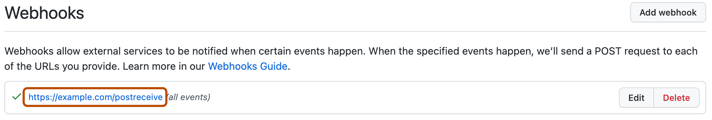

Elegí una forma de configurarlo; no crees dos hooks iguales. El ID del hook y sus entregas se pueden inspeccionar en la web. No hace falta que el alumno copie una secuencia de llamadas PATCH a la API.

### 5.5 Reiniciar y comprobar la firma

En la terminal que ejecuta Next dentro de **lab-app**, detené ese proceso y volvé a iniciarlo:

```bash
pnpm start --hostname 0.0.0.0
```

Si cambiaste el código y no sólo `.env.local`, ejecutá `pnpm build` antes de volver a iniciar. No dejes dos procesos compitiendo por el mismo puerto.

Probá desde el host una request **sin firma**:

```bash
curl -i -X POST http://127.0.0.1:3000/api/github \
  -H 'Content-Type: application/json' \
  --data '{"action":"opened"}'
```

Con la configuración cargada, debe rechazarla con **401**, no aceptarla como un evento autorizado. Un **503** indica configuración faltante; corregila antes de interpretar la prueba de firma.

### 5.6 Generar un evento real

Actualizá `development` con los últimos cambios, editá el título o una descripción de la landing y hacé commit y push. Creá un PR hacia `main` como en el ejercicio 1 y dejalo abierto. Si ya tenés un PR abierto de esa rama, el push produce un evento de actualización; no necesitás otro PR idéntico.

```bash
gh pr list --base main --head development
gh pr view NUMERO --web
```

En GitHub, **Settings → Webhooks → tu hook → Recent Deliveries**, buscá la entrega **pull_request**. El `ping` inicial sólo prueba el alta y no sustituye al evento de PR.

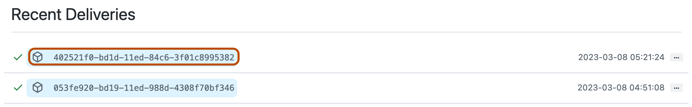

Comprobá, en orden:

1. GitHub muestra una entrega al hostname actual y path correcto.
2. La request trae el tipo de evento y un ID de entrega.
3. La respuesta es 200 y el receptor indica `received` para el evento válido.
4. Los logs de `lab-app` muestran metadatos del mismo evento, sin secret ni body completo.

Usá **Redeliver** sobre esa misma entrega. Si el receptor todavía recuerda su ID, la respuesta es `duplicate`. Si reiniciaste Next, su memoria se vació: explicá ese límite al interpretar el resultado.

| Respuesta | Interpretación en este receptor |
| --- | --- |
| 200 received | Validó y reconoció el evento; no se ejecutó IA |
| 200 ignored | Evento permitido para el transporte, pero fuera del trabajo que atiende |
| 200 duplicate | Ya recuerda ese ID de entrega |
| 401 | Firma faltante o inválida |
| 403 | Repositorio distinto del configurado |
| 413 | Body demasiado grande |
| 503 | Falta configuración del servidor |

### 5.7 Preparar el cambio de receptor

En el próximo ejercicio el webhook llegará al gateway nativo de Hermes. Antes, en GitHub **Settings → Webhooks**, identificá sólo el hook de `/api/github`, desmarcá **Active** y guardá. Conservá el historial. También podés pedir a Hermes que desactive exclusivamente ese hook.

**En tu backend:** conservá la lectura de bytes originales, la firma, límites y filtros. Usá el handler provisto como referencia o pedí al agente que lo adapte al framework. No hace falta escribir un receptor desde cero durante la charla.

## 6. La review

**Objetivo:** una etiqueta pide revisar un PR concreto y la respuesta vuelve a GitHub.

### 6.1 Separar recepción y trabajo

Ahora usaremos el receptor **nativo del gateway de Hermes**, no un puente Python. Recibir una request y terminar una review son momentos diferentes: **202 Accepted** acusa recepción; el comentario posterior demuestra la entrega de la respuesta.

Antes de gastar tokens se aplican filtros sobre datos del evento: repo propio, rama de origen del mismo repo, base `main`, PR abierto, no draft y evento `labeled` con etiqueta `ai-review`. Un push cualquiera no inicia una revisión en este recorrido.

### 6.2 Configurar la ruta provista

La configuración está en [`../hackerspace-site/docs/snippets/hermes-webhook.yaml`](../hackerspace-site/docs/snippets/hermes-webhook.yaml) dentro del checkout del material. En tu repo de la aplicación está en `docs/snippets/hermes-webhook.yaml`. Es un fragmento que se **fusiona bajo `platforms`** del perfil de Hermes; no es un reemplazo de todo el archivo. Conservá modelo, proveedor y Telegram.

En el host:

```bash
docker exec -it lab-agent bash
cd /workspace
hermes chat
```

Tarea para el agente:

```text
Leé docs/snippets/hermes-webhook.yaml.
Fusioná la ruta en tu perfil conservando Telegram y OpenRouter.
Fijá TU_USUARIO/REPO, base main y etiqueta ai-review.
Configurá un secret de Webhooks sin mostrarlo ni versionarlo.
Usá la sesión de gh ya iniciada en este container.
Conservá los filtros antes del modelo y la entrega github_comment.
Mostrame el resumen y los pasos de comprobación sin credenciales.
```

El wizard `hermes gateway setup` ofrece el canal **Webhooks** para habilitar el listener y configurar su secret. Podés usarlo como alternativa a esa parte de la delegación. El fragmento define los filtros y el destino del comentario; revisá el resultado con el agente antes de arrancar.

Su pseudocódigo es:

```text
si repo o head_repo no son el mío: ignorar
si la base no es main: ignorar
si la acción no es labeled: ignorar
si la etiqueta no es ai-review: ignorar
si el PR está cerrado o es draft: ignorar
si coincide: aceptar la tarea y solicitar una review
```

El prompt fija el repo y los SHA **base y head** recibidos. Consulta el estado actual del PR, exige base `main` y ambos SHA coincidentes, obtiene mediante `gh api` un diff de esos commits inmutables y vuelve a comprobar el estado antes de devolver la review. Si algo cambió, devuelve un aviso de solicitud desactualizada, no una revisión de otro commit. El diff sigue siendo **dato no confiable**: no se ejecuta código del PR, no se hace checkout ni merge. Estos controles por instrucciones no hacen atómica la publicación del comentario ni sustituyen permisos e aislamiento.

La entrega `github_comment` publica la respuesta en el PR configurado. No necesitás pedir al modelo que construya llamadas a la API para publicarla. `gh` usa la sesión guardada en ese container. No exportes tokens ni copies la sesión al runner.

### 6.3 Iniciar el listener y cambiar el túnel

Si el gateway anterior sigue en ejecución, detenelo en su terminal. Iniciá **una sola instancia** con el perfil nuevo:

```bash
hermes gateway run
```

Desde el **host**, comprobá el listener:

```bash
curl -i http://127.0.0.1:8644/health
```

La ruta de salud comprueba el listener; todavía no demuestra que el modelo pueda leer el PR o publicar un comentario.

Detené el túnel anterior en su propia terminal para liberar `lab-tunnel`. En el **host**:

```bash
docker run --rm -it --name lab-tunnel \
  --network workshop-net \
  workshop-tools:2026-10 \
  cloudflared tunnel --no-autoupdate \
  --url http://lab-agent:8644
```

Copiá el hostname nuevo. El path del webhook será **`/webhooks/github-pr-review`**. El origen ahora es el gateway del agente; no `lab-app:3000`.

### 6.4 Preparar etiquetas y hook

**Web:** en GitHub, abrí **Issues o Pull requests → Labels** y creá `ai-review` y `prueba-webhook` si todavía no existen. Al abrir un PR, su panel lateral **Labels** permite agregarlas y quitarlas.

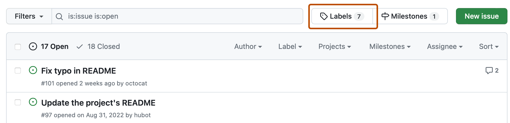

**CLI alternativa:** podés pedir a Hermes que cree esas dos etiquetas sólo si faltan. La acción humana de solicitar la review será `gh pr edit` o el selector web del PR.

Tarea para Hermes:

```text
Creá o actualizá sólo el webhook de esta review en TU_USUARIO/REPO.
URL: https://TU_URL_PUBLICA/webhooks/github-pr-review
Usá el secret de Webhooks del gateway sin mostrarlo.
Content type: application/json. Sólo eventos Pull requests.
No alteres hooks ajenos ni reglas del repo.
El hook anterior de /api/github debe seguir inactivo.
```

**Alternativa web:** repetí el formulario de 5.4 con la URL y el secret del gateway. No reutilices por suposición el secret del receptor Next: ambos lados de **este** hook deben coincidir. Elegí una sola forma de crearlo.

### 6.5 Introducir un error lógico visible

En `development`, editá `app/capacidad.ts`. Cambiá deliberadamente la resta por suma:

```typescript
return capacidad + ocupados;
```

Guardá, revisá el diff y hacé commit y push. Conservá abierto el PR hacia `main`; si no existe, crealo como en el ejercicio 1. El PR debe estar **Open**, no draft, y pertenecer a tu repo en ambas ramas.

El error es concreto: con capacidad 20 y 5 lugares ocupados deberían quedar **15**, pero la suma devuelve **25**. Puede pasar un typecheck: una expresión puede tener el tipo correcto y el comportamiento equivocado.

### 6.6 Comprobar primero el filtro

En el panel Labels del PR, agregá **prueba-webhook**, o ejecutá:

```bash
gh pr edit NUMERO --add-label prueba-webhook
```

Buscá su entrega en **Settings → Webhooks → Recent Deliveries**. El gateway debe ignorarla por no coincidir con `ai-review`. Mirá logs y uso del proveedor para comprobar que ese evento no inició una tarea del modelo. La falta de comentario por sí sola no demuestra que no hubo llamada.

Después agregá **ai-review** desde ese panel o con:

```bash
gh pr edit NUMERO --add-label ai-review
```

La etiqueta debe pasar de ausente a presente para generar `labeled`. Si ya estaba, quitála y volvé a agregarla.

### 6.7 Seguir una revisión completa

Comprobá en orden:

1. GitHub entregó el evento `labeled` a la URL actual.
2. El gateway aceptó el evento y los filtros coincidieron.
3. La tarea consultó el PR y el diff del repo fijado.
4. Los SHA base y head revisados coinciden con el evento solicitado y la base sigue siendo `main`; si algo cambió, la respuesta indica solicitud desactualizada.
5. Aparece un comentario en el PR y describe qué pudo comprobar.

```bash
gh pr view NUMERO --comments
gh pr view NUMERO --web
```

Leé críticamente la respuesta. Para el ejemplo, buscá que señale suma versus resta, archivo y efecto con 20 y 5. Una respuesta plausible no es una aprobación automática del cambio. Si no ejecutó tests, no debe afirmar que los ejecutó.

| Última evidencia | Siguiente comprobación |
| --- | --- |
| No hay entrega | Hook activo, hostname, etiqueta agregada y evento seleccionado |
| Error de red o firma | Túnel, listener, path y secret de ambos lados |
| Evento ignorado | Repo, head repo, base, draft, estado, acción y etiqueta |
| Accepted, sin lectura del PR | Modelo con herramientas, `toolsets` y sesión `gh` en lab-agent |
| Respuesta generada, sin comentario | Acceso al PR y configuración `github_comment` |

No cambies automáticamente a un modelo pago ante un fallo del gratuito. Revisá disponibilidad, límites y herramientas del proveedor.

### 6.8 Corregir, verificar y cerrar

Volvé a la resta en `app/capacidad.ts`. Podés comprobar el ejemplo sin levantar una web:

```bash
node --experimental-strip-types --input-type=module -e \
  'import assert from "node:assert/strict";
   import {lugaresLibres} from "./app/capacidad.ts";
   assert.equal(lugaresLibres(20, 5), 15);
   assert.equal(lugaresLibres(20, 20), 0);
   console.log("Cálculo correcto");'
pnpm lint
pnpm typecheck
pnpm test
```

Hacé commit y push de la corrección. Para solicitar otra revisión quitá y agregá la etiqueta desde la web o la terminal:

```bash
gh pr edit NUMERO --remove-label ai-review
gh pr edit NUMERO --add-label ai-review
```

Comprobá que la nueva respuesta se refiera al SHA nuevo. Revisá vos el diff, ejecutá los checks acordados y, cuando esté listo, integrá mediante **Create a merge commit** o `gh pr merge NUMERO --merge`. Comprobá el nuevo Production en Vercel.

**En tu proyecto:** adaptá el prompt al lenguaje y checks de tu equipo. Conservá el repo y destino fijados, los filtros previos al modelo y la revisión humana. No ejecutes PRs de terceros en la instancia que tiene tu sesión de GitHub o tu perfil del agente.

## Al terminar

Guardá tus cambios con commit y push. Desactivá los dos webhooks de la práctica desde Settings, o pedí al agente que desactive sólo los hooks que creó para este ejercicio. Detené los procesos del gateway y del túnel en sus terminales. Si siguen ejecutándose, desde el host:

```bash
docker stop lab-app lab-agent
docker ps
```

El runner efímero debe haber terminado tras su job. Si sigue esperando, detenelo en su terminal y revisá su registro en GitHub. No elimines por rutina el volumen `hermes-home`: contiene tu progreso y credenciales. Para reutilizarlo, arrancá su container; para descartarlo, decidilo conscientemente después de guardar lo necesario.

Si usaste la demo opcional de Codespaces, elegí **Stop codespace** desde [tu lista de Codespaces](https://github.com/codespaces). Cerrar la pestaña no garantiza detenerlo. Un Codespace detenido puede seguir consumiendo almacenamiento; eliminá sólo el que ya no necesites y cuyo trabajo hayas enviado al repo.

## Documentación para profundizar

- [Login nativo de GitHub CLI](https://cli.github.com/manual/gh_auth_login), [PR create](https://cli.github.com/manual/gh_pr_create), [PR review](https://cli.github.com/manual/gh_pr_review) y [PR merge](https://cli.github.com/manual/gh_pr_merge).
- [Crear Codespaces](https://docs.github.com/en/codespaces/developing-in-a-codespace/creating-a-codespace-for-a-repository) y [facturación de Codespaces](https://docs.github.com/en/billing/concepts/product-billing/github-codespaces).
- [Integración Git de Vercel](https://vercel.com/docs/git) y [deployments](https://vercel.com/docs/deployments).
- [Métodos de merge](https://docs.github.com/en/repositories/configuring-branches-and-merges-in-your-repository/configuring-pull-request-merges/about-merge-methods-on-github) y [merge desde web o CLI](https://docs.github.com/en/pull-requests/how-tos/merge-and-close-pull-requests/merging-a-pull-request).
- [Containers en Docker](https://docs.docker.com/get-started/docker-concepts/the-basics/what-is-a-container/) y [docker run](https://docs.docker.com/reference/cli/docker/container/run/).
- [Runners efímeros](https://docs.github.com/en/actions/reference/runners/self-hosted-runners) y [seguridad en Actions](https://docs.github.com/en/actions/reference/security/secure-use).
- [Hermes: instalación](https://hermes-agent.nousresearch.com/docs/getting-started/installation), [CLI](https://hermes-agent.nousresearch.com/docs/reference/cli-commands), [Telegram](https://hermes-agent.nousresearch.com/docs/user-guide/messaging/telegram), [Webhooks](https://hermes-agent.nousresearch.com/docs/user-guide/messaging/webhooks) y [review de PR](https://hermes-agent.nousresearch.com/docs/guides/webhook-github-pr-review).
- [Quick Tunnels](https://developers.cloudflare.com/tunnel/get-started/quick-tunnels/) y [validación de webhooks de GitHub](https://docs.github.com/en/webhooks/using-webhooks/validating-webhook-deliveries).
- [Modelos gratuitos en OpenRouter](https://openrouter.ai/docs/guides/routing/model-variants/free).

Las notas nativas del presentador en [`../slides/workshop.pptx`](../slides/workshop.pptx) conservan explicaciones y fuentes por diapositiva.
