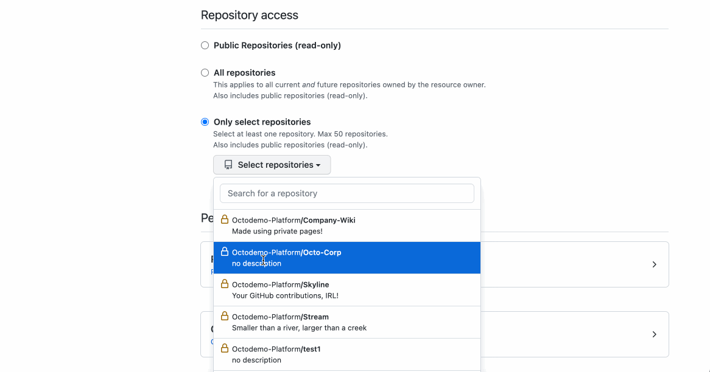
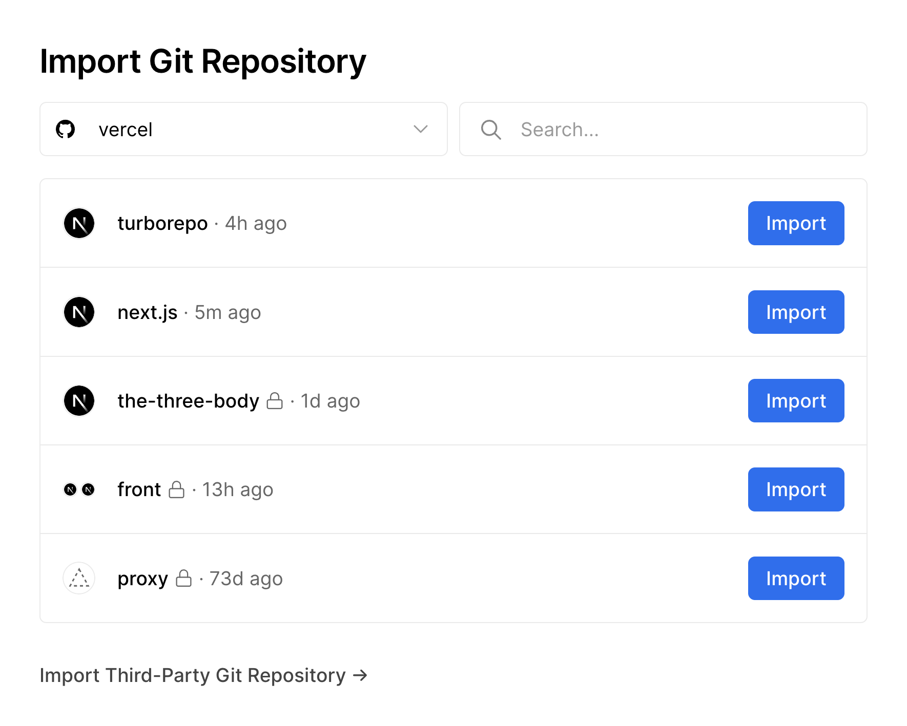
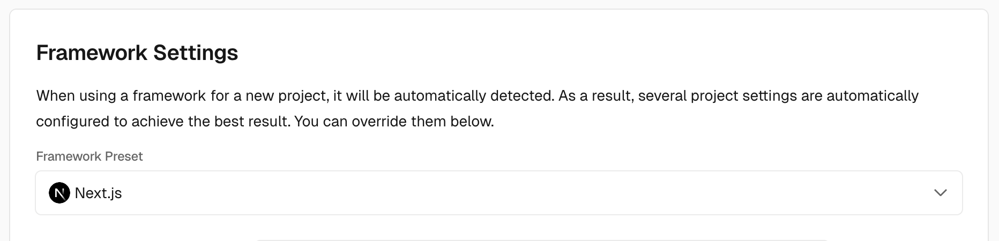
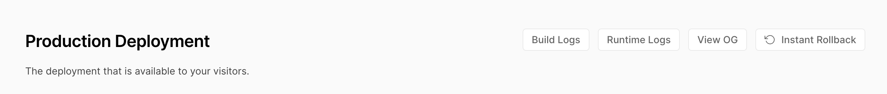
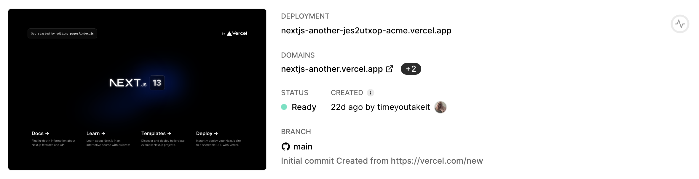
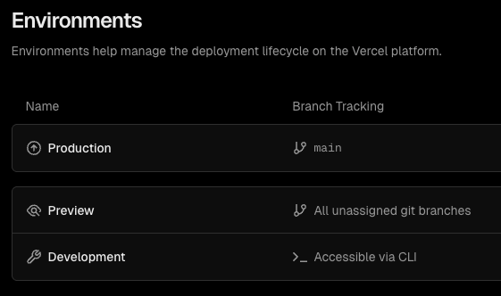
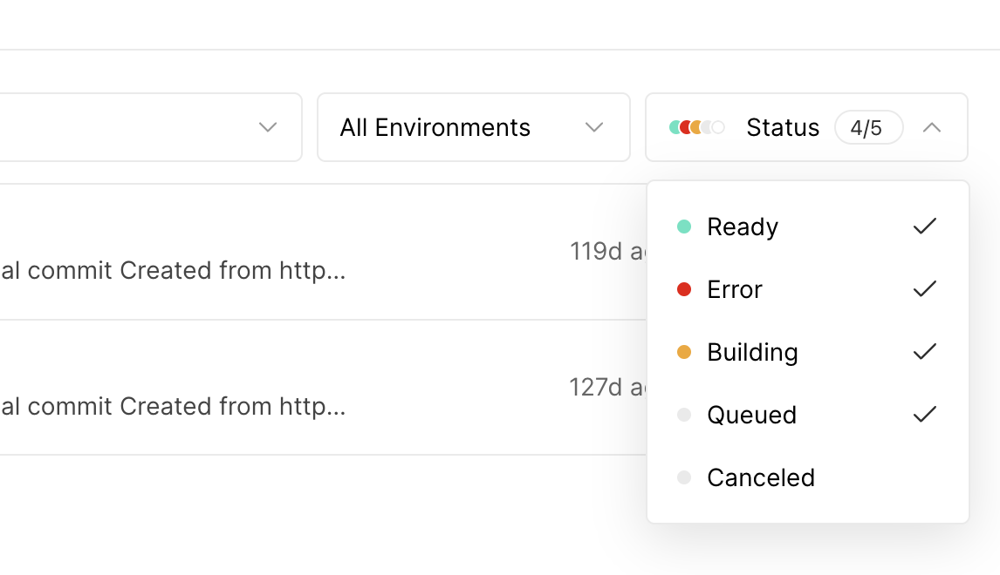
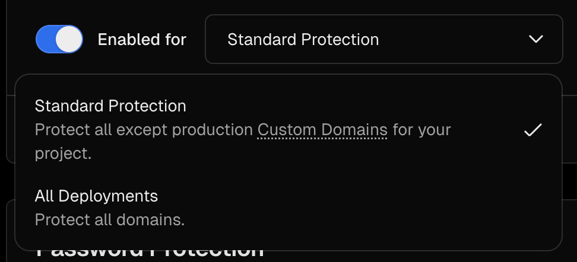
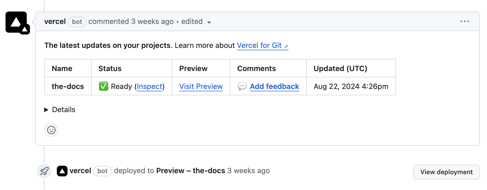
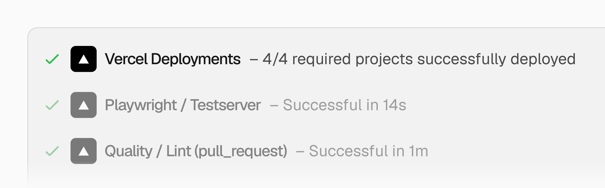

# GitHub × AI Automation Lab

Construí una landing, publicá dos versiones y conectá GitHub con un runner, un agente y una revisión solicitada por webhook. El ejemplo es el HackerSpace de Nodo Serrano. En cada ejercicio se explica cómo trasladarlo a tu proyecto.

**Recorrido recomendado: tu equipo y containers.** Los seis ejercicios se siguen desde el host, usando Docker cuando aparece en el ejercicio 2. La [demo opcional de la landing en Codespaces](#19-demo-opcional-la-landing-en-codespaces) queda al final del ejercicio 1, después de publicar y comprobar el repo. No valida de punta a punta runner, Hermes, Telegram, túnel y reviews ni es un plan alternativo para completar la clase.

| Ejercicio | Resultado que vas a comprobar |
| --- | --- |
| [1. Proyecto y deploy](#1-proyecto-y-deploy) | Production desde `main`, Preview desde `development` y un PR integrado |
| [2. Docker y runner](#2-docker-y-runner) | Un check pasa, falla por un error deliberado y vuelve a pasar |
| [3. Hermes y Telegram](#3-hermes-y-telegram) | Una conversación desde la terminal y otra desde Telegram |
| [4. El túnel](#4-el-túnel) | La misma respuesta local se puede consultar por una URL HTTPS pública |
| [5. El webhook](#5-el-webhook) | GitHub envía un evento firmado y el receptor responde |
| [6. La review](#6-la-review) | Una etiqueta solicita una revisión y la respuesta aparece en el PR |

Las capturas proceden de documentación oficial o referencias públicas identificadas; pueden mostrar interfaces históricas y repositorios de ejemplo. No prueban una ejecución de nuestras cuentas. Los editores ilustrativos y los bloques **Ejemplo de salida** se rotulan como tales. Compará los datos de tu propia ejecución: una URL o un mensaje de ejemplo no prueban que tu integración funcione.

## Cómo leer los comandos

Usá Bash en Linux, macOS o [WSL2](https://learn.microsoft.com/en-us/windows/wsl/install). En Windows con Docker Desktop, abrí el proyecto dentro de WSL2. No copies estos bloques directamente a PowerShell.

- `TU_USUARIO/REPO`: reemplazalo por el propietario y nombre de **tu** repositorio.
- `NUMERO`: número real del PR; no lleva `#` en los comandos.
- `RUN_ID`: identificador que devuelve `gh run list`.
- `TU_URL_PUBLICA`: hostname real que imprime cloudflared; no agregues `https://` dos veces.
- Una línea que termina en `\` continúa en la siguiente. Podés pegar el bloque completo.
- Las líneas que empiezan con `#` son comentarios.
- El texto bajo `text` muestra una salida o una tarea para el agente; no es un comando de Bash.

Las etiquetas **host**, **lab-agent** y **lab-app** indican dónde ejecutar cada comando. En el recorrido recomendado, **host** es tu equipo o WSL2; las otras dos etiquetas son containers que crearemos más adelante. La demo opcional de Codespaces usa su terminal remota sólo para el alcance indicado.

Cuando un proceso ocupa la terminal, abrí otra terminal para el siguiente comando. Para detenerlo usá `Ctrl+C` en esa terminal. No hace falta cerrar el entorno.

## 1. Proyecto y deploy

**Objetivo:** publicar la landing primero y aprender branches y PR sobre un cambio visible.

### 1.1 Clonar el material y mover la app

Necesitás [Git](https://git-scm.com/install/), [GitHub CLI](https://cli.github.com/) y acceso de lectura al material. Este repo todavía es privado: resolvé ese acceso antes del taller con tu cuenta o credencial existente. El token que crearás para tu sitio no permite leer este repo privado.

En una terminal Bash de tu equipo:

```bash
git clone https://github.com/theredguild/github-ai-automation-lab.git
cd github-ai-automation-lab
```

Elegí una carpeta de destino **que todavía no exista**, al lado del material. En el ejemplo se llama `lab`. Mové la app completa:

```bash
mv hackerspace-site ../lab
```

No hagas `mkdir lab` antes: `mv` crea ese destino al mover la carpeta. Si `lab` ya existe o el comando falla, detenete y elegí otro nombre. No vuelvas a copiar ni inicializar nada hasta resolverlo.

Ahora entrá en la app:

```bash
cd ../lab
pwd
```

Debe terminar en `/lab`. En el editor tienen que verse estos archivos:

```text
lab/
  app/
  public/
  package.json
  pnpm-lock.yaml
  Dockerfile
  .dockerignore
  .gitignore
  .devcontainer/
    devcontainer.json
```

Si falla el `cd` o no ves esa estructura, detenete: **no ejecutes `git init` en el material**. Mover la carpeta incluye sus archivos ocultos, pero no la `.git` del taller, que estaba un nivel arriba. No hay que borrar ninguna `.git`. El checkout del material mostrará la carpeta movida como eliminada; no confirmes esos cambios allí. Desde ahora trabajás sólo en `lab`.

`Dockerfile` está dentro de la app, al lado de `package.json`. `.devcontainer/` configura únicamente la demo remota posterior; no reemplaza ese Dockerfile. Guía y presentación quedan en el material o se consultan desde GitHub.

### 1.2 Crear tu repo, limitar el token y publicar

#### Crear un repositorio vacío en la web

Abrí [New repository](https://github.com/new). Usá tu cuenta personal, un nombre como `nodoserrano-hackerspace` y visibilidad **Private**. Dejalo **vacío: sin README, licencia ni `.gitignore`**. Esos archivos llegarán desde tu carpeta local; no uses Upload files para iniciar otra historia.


#### Un token para este repositorio

Un **personal access token** es una credencial, no una contraseña para poner en el código. Abrí [Fine-grained personal access tokens → Generate new token](https://github.com/settings/personal-access-tokens/new):

1. Nombre reconocible y vencimiento corto, por ejemplo 7 días.
2. **Resource owner:** tu cuenta personal.
3. **Repository access → Only select repositories:** únicamente el repo privado que acabás de crear.
4. **Repository permissions:** `Contents: Read and write` y `Pull requests: Read and write`. `Metadata: Read-only` se incluye automáticamente. Estos permisos alcanzan para Git y los PR del ejercicio 1; no agregues permisos de cuenta ni Administration.



La captura histórica ubica el selector; los nombres de cuenta y repo son ejemplos. No copies los permisos de Issues que aparezcan en otras capturas. La restricción corresponde al repo privado seleccionado; estos tokens también pueden leer repos públicos. El token no concede derechos que tu cuenta no tenga. Si una organización exige aprobación, no supongas que ya funciona: para esta práctica usamos tu repo personal.

Generá el token y copialo en privado para el siguiente paso. **No lo proyectes, captures, guardes en el repo ni pegues en un chat.** [Documentación actual de tokens y permisos](https://docs.github.com/en/authentication/keeping-your-account-and-data-secure/managing-your-personal-access-tokens).

#### Login de GitHub CLI después de crear el repo

En el **host**, no dentro de Codespaces:

```bash
gh auth login
```

Elegí **GitHub.com → Paste an authentication token → HTTPS → Yes para autenticar Git**, y pegá el token en la entrada oculta. Es el orden de GitHub CLI 2.103.3; otra versión puede cambiar los textos. No elijas el flujo OAuth del navegador para sustituir este token limitado. La ayuda puede mencionar scopes de tokens clásicos; no son permisos que haya que agregar a este token fino.

```bash
gh auth status
```

Comprobá cuenta, origen de la credencial y protocolo. No uses opciones para mostrar el token. Si `GH_TOKEN` o `GITHUB_TOKEN` controlan esa terminal, pueden prevalecer sobre la sesión guardada: no imprimas ni borres esas variables a ciegas; resolvé el contexto de la terminal con el instructor.

Este login puede cambiar la credencial activa de `gh` y actualizar la credencial HTTPS de Git para GitHub. Otros repos privados podrían dejar de ser accesibles con este token, incluido el material del taller. Si aparece una advertencia de almacenamiento en texto plano, revisá el almacén de credenciales del equipo; no asumas que quedó cifrado ni uses `--insecure-storage`. [Login nativo](https://cli.github.com/manual/gh_auth_login).

#### Iniciar Git y hacer el primer push

Seguís en `lab`, donde están `package.json` y `Dockerfile`. Todavía no instalaste dependencias. El starter **ya trae `.gitignore`** para proteger archivos locales; lo explicaremos después del push.

```bash
git init -b main
git config user.name
git config user.email
```

Nombre y email del commit son distintos del login de GitHub. Si faltan o pertenecen a otra persona, configurá sólo este repo con tus datos:

```bash
git config user.name "Tu nombre"
git config user.email "TU_EMAIL"
```

Prepará y revisá el contenido antes de confirmar:

```bash
git add .
git status
```

Deben aparecer la app y su configuración, no guía, slides, dependencias ni secretos. Si no es así, detenete. Después:

```bash
git commit -m "Inicio del sitio"
git remote add origin https://github.com/TU_USUARIO/REPO.git
git push -u origin main
```

Reemplazá `TU_USUARIO/REPO` por tu repo recién creado. Esperá el push sin error y abrilo en GitHub: deben estar `app/`, `package.json`, `Dockerfile` y `.gitignore` en raíz. **No vuelvas a clonar:** seguís trabajando en esta misma carpeta `lab`.

### 1.3 .gitignore, instalación y build

Abrí `.gitignore` en el editor. Ya viene incluido; no tenés que inventar esas reglas para poder hacer el primer push. Le dice a Git qué archivos locales nuevos no debe añadir. Por ejemplo:

```gitignore
**/node_modules/
**/.next/
.env
.env.*
!.env.example
```

`node_modules/` contiene dependencias descargables y `.next/` contiene archivos generados. `.env.local` puede contener secretos. `.env.example` sí se guarda porque documenta las variables sin credenciales. El archivo completo también excluye otros caches. **Ignorar no deja de seguir algo que ya se había versionado.**

Prepará [Node 22](https://nodejs.org/en/download) y [pnpm 10.20.0](https://pnpm.io/installation) en tu equipo:

```bash
node --version
pnpm --version
```

Desde la misma carpeta `lab`, instalá:

```bash
pnpm install --frozen-lockfile
```

Después construí:

```bash
pnpm build
```

Esperá que termine sin errores. El build genera `.next/`; no es un deployment. Si falla, leé el primer error antes de seguir. Ahora iniciá desarrollo:

```bash
pnpm dev
```

Abrí `http://localhost:3000` o el puerto indicado por Next. Dejá esa terminal abierta mientras comprobás título, actividades e imagen. Todavía no usaste Docker y esa URL no es Production de Vercel.

| Archivo | Para qué lo usamos |
| --- | --- |
| `app/page.tsx` | Contenido de la landing |
| `app/globals.css` | Estilos |
| `app/estado.ts` | Un número tipado para practicar un error de TypeScript |
| `app/capacidad.ts` | Un cálculo para practicar una review |
| `app/api/health/route.ts` | Respuesta sencilla para observar la red |
| `app/api/github/route.ts` | Receptor preparado para el ejercicio 5 |

En otra terminal de `lab`, mirá qué quedó ignorado:

```bash
git status --ignored
```

Dependencias y build deben aparecer como ignorados, no como archivos preparados para un commit. No se suben con `git add .`. Detené `pnpm dev` con `Ctrl+C` cuando termines de verlo.

#### Si tu repo ya incluye archivos generados

Esto es una reparación opcional para un repo existente, no otro paso obligatorio del starter. Comprobá el seguimiento:

```bash
git ls-files node_modules .next
```

Sin salida significa que no están versionados. Si lista archivos, revisá `.gitignore` en el editor y ejecutá **sólo la línea correspondiente a cada carpeta seguida**:

```bash
git rm -r --cached node_modules
```

```bash
git rm -r --cached .next
```

`--cached` quita el seguimiento sin borrar los archivos de tu disco. No agregues `-f` si Git rechaza la operación. Después revisá `git status`, añadí `.gitignore` si lo modificaste y confirmá/publicá la reparación. No quites todo el proyecto del índice.

Esto no elimina archivos de commits anteriores. Un push rechazado por archivos grandes puede necesitar revisar el historial con el instructor, no un force-push improvisado. Si publicaste una credencial, revocala o rotala. [Referencia de `.gitignore`](https://docs.github.com/en/get-started/git-basics/ignoring-files).

### 1.4 Conectar Vercel

Abrí [Vercel → New Project](https://vercel.com/new), iniciá sesión y elegí **Import Git Repository**. Conectá la **GitHub App de Vercel** y autorizá sólo tu repo personal de la práctica. Es una integración distinta del PAT de tu terminal: **no pegues ese token en Vercel**. Si falta el repo, usá **Configure GitHub App** o GitHub **Settings → Applications → Installed GitHub Apps → Vercel → Configure**, revisá **Only select repositories** y guardá.



Comprobá la configuración antes de pulsar **Deploy**:

| Campo | Valor de este proyecto |
| --- | --- |
| Framework Preset | Next.js |
| Root Directory | `.`: raíz de tu propio repositorio de la aplicación, no del material del taller |
| Install Command | Dejar la autodetección por `pnpm-lock.yaml`, sin activar Override |
| Build Command | `pnpm build` |
| Node.js | 22.x, en la configuración disponible del proyecto |
| Production Branch | `main` |



La captura muestra la ubicación del selector, no un deployment del taller. Usá los valores de la tabla y no copies overrides de otros proyectos.

No hace falta cargar secretos para publicar esta landing. El receptor de webhooks se usará localmente más adelante; sus secretos no deben terminar en variables `NEXT_PUBLIC_*`.

No sobrescribas Install Command con un `pnpm install` genérico: Vercel puede seleccionar otra versión del gestor. Para fijar exactamente `pnpm@10.20.0` en Vercel, habilitá Corepack según su documentación; no hace falta para el camino básico de autodetección.

Pulsá **Deploy**, abrí **Build Logs** y esperá **Ready**. Si falla, leé el primer error del build. Ready indica que el deployment está preparado; también hay que abrir su URL y comprobar la landing.





En **Project → Settings → Git**, corroborá el repo conectado. En **Settings → Environments → Production → Branch Tracking**, verificá `main`. En el detalle del deployment revisá entorno **Production**, estado, rama, commit y URL; abrí el enlace del commit en GitHub y compará su SHA. La captura es de otro proyecto y no demuestra nuestra publicación.



El primer deployment del proyecto es Production; por eso empezamos importando `main`. No crees otro proyecto Vercel para obtener el Preview. Usá tu repo personal: un repo privado de organización puede exigir un plan que no sea Hobby; no cambies visibilidad ni actives pagos como arreglo automático. [Integración Git](https://vercel.com/docs/git), [entornos](https://vercel.com/docs/deployments/environments).

### 1.5 Hacer un cambio en development

Guardar un archivo modifica tu copia de trabajo. **Commit** guarda una versión en la historia local. **Push** la envía al repositorio de GitHub. Una branch es una referencia a un commit; un SHA identifica ese commit.

```bash
git switch main
git pull --ff-only
git switch -c development
```

#### `switch` y `checkout`

`git switch -c development` crea la rama y cambia a ella. `git switch main` vuelve a una rama existente. `checkout` es el comando anterior y tiene más funciones, incluida restauración de archivos:

| Intención | Comando usado aquí | Equivalente anterior |
| --- | --- | --- |
| Crear y entrar en una rama | `git switch -c development` | `git checkout -b development` |
| Cambiar a main existente | `git switch main` | `git checkout main` |

Son alternativas, no pasos para ejecutar todos. Usamos `switch` porque deja clara la intención de cambiar de rama. Si Git advierte que perderías cambios locales, detenete y revisá `git status`; no fuerces el cambio. [Manual de switch](https://git-scm.com/docs/git-switch).

En el editor, buscá el título visible de `app/page.tsx` y cambialo por una frase que reconozcas, por ejemplo, “El HackerSpace de Nodo Serrano”. Guardá y revisá:

```bash
git status
git diff
git add app/page.tsx
git commit -m "Actualiza la portada del HackerSpace"
git push -u origin development
git log -1 --oneline
git rev-parse --short HEAD
```

Si Git pide identidad en esta copia de trabajo, repetí la comprobación y configuración local de 1.2 con tus datos reales. Repetí el commit después.

**Alternativa web:** en GitHub, selector de branches → crear `development` desde `main`; abrí `app/page.tsx`, pulsá el lápiz, editá y confirmá el cambio en `development`. Conservá esta rama para los siguientes ejercicios.

### 1.6 Comparar Preview y Production

Con la integración Git, **Preview viene habilitado por defecto** después del primer deployment. El push a `development`, que no es la rama productiva, genera un Preview. No hace falta crear un workflow de Actions ni comprar una función adicional.

En el mismo proyecto de Vercel, abrí **Deployments**, filtrá rama `development` y entorno **Preview**. Comprobá **Ready**, rama y SHA del commit que subiste. Abrí la URL única de ese deployment y buscá el título nuevo; Production debe conservar el anterior hasta el merge.



Si no aparece, revisá repo conectado, acceso de la GitHub App y **Environments → Production → Branch Tracking = main**. Preview debe incluir las ramas no asignadas. El entorno de Vercel llamado **Development** no es nuestra rama Git `development`: esa rama del taller debe desplegar como Preview.

En un proyecto que ya tenía configuración, comprobá que `git.deploymentEnabled` no excluya esa rama y que **Build and Deployment → Ignored Build Step** no esté configurado para construir sólo Production o cancelar todo. No agregues esas opciones al camino básico. [Configuración de Git](https://vercel.com/docs/project-configuration/git-configuration).

**Preview creado** y **Preview accesible sin login** son cosas distintas. Si hay protección, usá tu sesión autorizada. No desactives seguridad para simular que funciona.



### 1.7 Crear y revisar un pull request

Un PR propone integrar los cambios de una rama en otra. **Compare / head** aporta los cambios; **base** los recibe. En este taller: `development → main`.

**Web:** **Pull requests → New pull request**, elegí **base: main** y **compare: development**. Verificá el diff, escribí título y descripción y pulsá **Create pull request**.


La captura oficial usa otros repositorios y branches. En tu formulario seleccioná los valores de tu ejercicio.

**CLI alternativa:**

```bash
gh pr create --base main --head development \
  --title "Actualiza la portada del HackerSpace" \
  --body "Cambia el titulo visible de la landing."
gh pr list --base main --head development
gh pr view NUMERO --json number,title,state,url
gh pr diff NUMERO
gh pr view NUMERO --web
```

#### Corroborar la integración desde GitHub y Vercel

En el PR de GitHub buscá el estado de Vercel del último commit y el comentario del bot con **Ready**, **Visit Preview**, **Inspect** o **View deployment**. Abrí ese enlace y comprobá en Vercel repo, rama, SHA, entorno y URL. Vercel es quien construye: ese estado no es nuestro workflow manual de Actions del ejercicio 2.





Las capturas son ejemplos públicos distintos, no dos mitades de nuestra ejecución. La prueba del participante debe enlazar **su PR y SHA** con **su deployment Preview, estado y URL**. La URL de rama puede cambiar con otro push; la URL única identifica un deployment concreto. Si no aparece el comentario del bot, consultá Deployments: los comentarios pueden desactivarse sin detener deployments. [Vercel para GitHub](https://vercel.com/docs/git/vercel-for-github).

En **Files changed**, verde muestra líneas agregadas y rojo líneas eliminadas. Leé el cambio antes de integrar. En **Review changes** podés comentar, aprobar o pedir cambios según tus permisos. GitHub no permite aprobar tu propio PR; para una práctica individual usá un comentario. Si trabajan de a dos, la otra persona puede hacer la review.


**CLI alternativa para comentar:**

```bash
gh pr review NUMERO --comment \
  --body "Revisé el cambio del título."
```

Sobre el PR de otra persona podés usar `--approve` o `--request-changes` en lugar de `--comment`, con un motivo en `--body`.

### 1.8 Elegir cómo integrar

| Método | Qué agrega a main | Cuándo conviene |
| --- | --- | --- |
| Create a merge commit | Conserva los commits de la rama y agrega un commit con dos padres | Este taller: `development` se reutiliza |
| Squash and merge | Agrupa los cambios del PR en un commit nuevo | Una rama corta que termina después del PR |
| Rebase and merge | Reaplica los commits uno a uno, con SHA nuevos y sin commit de merge | Historia lineal acordada con el equipo |

Estas son alternativas. No ejecutes las tres sobre el mismo PR. En una rama larga, squash puede volver confusas las comparaciones de PR posteriores porque los commits originales siguen en la rama.


**Web:** en **Conversation**, bajá hasta el botón verde, abrí su flecha, elegí **Create a merge commit** y confirmá. Conservá `development`.

**CLI alternativa:**

```bash
gh pr merge NUMERO --merge
gh pr view NUMERO --json state,mergeCommit
```

Si una regla exige checks o aprobación, atendé ese requisito. No uses bypass. Después del merge, Vercel debe construir un nuevo Production de `main`. Abrí esa URL y comprobá el título nuevo y el SHA del deployment.

**Antes de seguir:** identificá tu repo, el PR integrado, la URL de Production y la de Preview. Si usás otro proyecto, reemplazá sólo framework, comandos y carpeta raíz; Git, branches, PR y la integración Git siguen el mismo recorrido.

### 1.9 Demo opcional: la landing en Codespaces

Esta demo breve viene **después** del push correcto, el build local, Production y Preview funcionando y el PR integrado. No reemplaza el recorrido del host ni habilita los ejercicios 2–6 en Codespaces.

Abrí [GitHub Codespaces](https://github.com/codespaces) o **Code → Codespaces** en tu repo **propio ya publicado**, con `main` funcionando. Preferí una instancia existente de tu cuenta. Antes de crear una, revisá [cuota y cuenta pagadora](https://docs.github.com/en/billing/concepts/product-billing/github-codespaces); no actives pagos para esta demo. Si decidís crearla, elegí `main` y 2 núcleos si están disponibles. [Procedimiento oficial](https://docs.github.com/en/codespaces/developing-in-a-codespace/creating-a-codespace-for-a-repository).

Codespaces hace el checkout del repo automáticamente. No crees otro repo ni clones de nuevo la app o el material dentro de él. En una instancia existente, comprobá primero:

```bash
git status
git branch --show-current
```

Sólo si el checkout está limpio y la branch es `main`, sincronizá y compará los dos SHA:

```bash
git pull --ff-only
git rev-parse HEAD origin/main
```

Los SHA deben coincidir. Si hay cambios locales, otra branch, falla el pull o los SHA difieren, omití la demo sin reset, force-push ni depuración en clase.

Comprobá Node 22 y pnpm 10.20.0. Si están disponibles, instalá y ejecutá la misma landing:

```bash
node --version
pnpm --version
pnpm install --frozen-lockfile
pnpm dev
```

En **Ports → 3000 → Open in Browser**, usá el puerto que muestre Next y mantenelo **privado**. Reconocé la landing; esa URL remota no es Production de Vercel ni un endpoint de webhook.


No ejecutes `gh auth login` ni `gh auth refresh`, ni borres o exportes variables de tokens. La autenticación automática tiene [permisos limitados](https://docs.github.com/en/codespaces/reference/security-in-github-codespaces). Si faltan acceso, herramientas o permisos, omití la demo y seguí en el host. La configuración `.devcontainer/devcontainer.json` no certifica el taller completo.

Al terminar, **Ctrl+C** detiene Next, pero no el entorno remoto. En [tu lista de Codespaces](https://github.com/codespaces), elegí **Stop codespace** para esa instancia. No la borres. Volvé a la terminal del host, carpeta `lab`, antes del ejercicio 2.

## 2. Docker y runner

**Objetivo:** ejecutar un check normal en un entorno propio y reconocer una falla.

### 2.1 Ubicar Host, VM y container

**Host** es la máquina que aloja procesos. Puede ser física o una VM. Una **VM** tiene su propio kernel y se ejecuta sobre un hipervisor. Un **container Linux** tiene procesos y filesystem aislados de otros containers; todos comparten el kernel Linux de su host. En el gráfico, cada borde marcado **Container A/B** encierra su proceso y archivos, no un kernel propio. En Docker Desktop, el host Linux suele estar dentro de una VM.

El **Dockerfile** es la receta, la **imagen** es el resultado de construirla y un **container** es una instancia en ejecución. Reutilizaremos una imagen de herramientas con instancias separadas para runner, agente y aplicación.

### 2.2 Leer el Dockerfile y construir la imagen

Seguís en **tu equipo**, carpeta `lab`, no en Codespaces. Prepará [Docker Desktop o Docker Engine](https://docs.docker.com/get-started/get-docker/) e iniciá su servicio:

```bash
docker version
```

Debe mostrar **Client y Server**. Si no conecta al daemon, iniciá Docker Desktop/Engine; reinstalar el cliente no resuelve eso.

Antes del build, abrí **`lab/Dockerfile` en el editor**. No está en la raíz del material del taller ni dentro de `.devcontainer/`. Estas instrucciones aparecen en la receta real:

```dockerfile
FROM node:22.23.4-bookworm-slim
RUN npm install --global pnpm@10.20.0
WORKDIR /workspace
USER node
CMD ["bash"]
```

Es un extracto para leer, no un Dockerfile nuevo que debas copiar. `FROM` elige la base, `RUN` instala durante la construcción, `WORKDIR` fija la carpeta de trabajo, `USER` evita ejecutar como root y `CMD` abre Bash al iniciar la instancia. La receta completa también instala Git, GitHub CLI, cloudflared y el runner con versiones y verificaciones de descarga. **No copia credenciales, no registra runners y no instala Hermes.** El proyecto se montará después.

#### Elegir el build antes de ejecutarlo

El instructor revisa permisos antes del taller. La imagen usa `node` con UID/GID `1000:1000` por defecto. En Linux con Docker Engine, comprobá tus IDs:

```bash
id -u
id -g
```

Si coinciden con `1000:1000`, el build básico es:

```bash
docker build -t taller .
```

`-t taller` sólo le da un nombre corto a la imagen. El punto usa el Dockerfile de esta carpeta. No vamos a versionar etiquetas en este ejercicio.

Si tus IDs Linux son distintos, usá **esta alternativa en lugar del build básico**, reemplazando ambos valores:

```bash
docker build -t taller \
  --build-arg WORKSHOP_UID=TU_UID \
  --build-arg WORKSHOP_GID=TU_GID .
```

No ejecutes luego el build básico sobre la imagen adaptada. No construyas desde una sesión root ni arregles permisos con `chmod 777`. Docker Desktop y rootless pueden traducir propietarios; comprobaremos escritura antes de cargar credenciales.

```bash
docker image ls taller
```

El store de pnpm queda fuera del proyecto. `.devcontainer/devcontainer.json` configura la demo opcional de Codespaces con una imagen Node independiente; **no se usa para este build** ni requiere Docker dentro de Codespaces.

Ahora creá una instancia de exploración:

```bash
docker run --rm -it --name herramientas taller
```

`CMD` abre Bash y `WORKDIR` nos deja en `/workspace`. Todavía no hace falta crear una red propia: la conexión entre containers aparece recién en el ejercicio 4.

Ahora estás **dentro del container**. Probá:

```bash
whoami
pwd
node --version
pnpm --version
```

Ejemplo de salida:

```text
node
/workspace
v22.x.x
10.20.0
```

Desde otra terminal del host, `docker exec -it herramientas bash` abre otra shell en esa misma instancia. `docker ps` muestra los containers que siguen ejecutándose. Cuando terminás de explorar, cerrá esas shells; `--rm` elimina esa instancia al finalizar. La imagen sigue disponible.

**Alternativa visual:** Docker Desktop muestra imágenes, containers y logs. El panel no reemplaza la shell del runner ni la consola del agente; para esos procesos usaremos los comandos nativos.

### 2.3 Preparar un workflow sencillo

GitHub Actions organiza el trabajo en **workflow → jobs → steps**. Un runner ejecuta los steps de un job. El check del ejemplo instala el lockfile, corre Biome y revisa tipos de TypeScript.

En el editor de `lab`, abrí `docs/snippets/checks.yml`. Ese archivo se movió con la app; ya no está en `hackerspace-site/` dentro de tu checkout del material. Leelo. Todavía no está activado en `.github/workflows/` para incorporarlo durante el ejercicio.

La parte inicial dice:

```yaml
name: Checks del workshop
on:
  workflow_dispatch:
permissions:
  contents: read
jobs:
  check:
    runs-on: [self-hosted, linux, workshop]
    timeout-minutes: 10
```

`workflow_dispatch` permite iniciarlo a mano. Las etiquetas seleccionan el runner. `contents: read` limita la credencial del job. El checkout está fijado a un commit y no conserva su credencial en Git.

**Para subirlo a main, la web es la opción más directa:** **Add file → Create new file**; nombre `.github/workflows/checks.yml`; pegá el archivo completo y confirmá en `main`. Si el repo exige PR, seguí su procedimiento.

Para iniciar workflows desde CLI, agregá **Actions: Read and write** al PAT del mismo repo. Si también enviás el archivo `.github/workflows/checks.yml` por Git, agregá **Workflows: Write**; la creación web no usa ese permiso del token. Los permisos se editan en GitHub, no con `gh auth refresh`. Si GitHub reemplaza el token al actualizarlo, repetí el login por entrada oculta. No agregues Administration ni permisos de cuenta para resolverlo.

**CLI alternativa:** en lugar de crearlo en la web, ejecutá desde el host:

```bash
git switch main
git pull --ff-only
mkdir -p .github/workflows
cp docs/snippets/checks.yml .github/workflows/checks.yml
git add .github/workflows/checks.yml
git commit -m "Agrega checks manuales"
git push origin main
```

Con el workflow ya en `main`, actualizá ambas ramas en tu copia:

```bash
git switch main
git pull --ff-only
git switch development
git merge main
git push origin development
```

Si seguiste la alternativa CLI y ya lo agregaste allí, no vuelvas a crear el mismo archivo desde la web. Revisá `git status` antes de cambiar de rama y guardá cualquier cambio pendiente.

### 2.4 Registrar un runner efímero

En GitHub, **Settings → Actions → Runners → New self-hosted runner**, elegí **Linux** y la arquitectura de tu equipo. Usaremos el runner ya descargado en la imagen; no repitas la instalación que muestra esa pantalla. Buscá el token temporal del comando de **Configure**.


En una terminal nueva del **host**:

```bash
docker run --rm -it --name lab-runner taller
```

Dentro de **lab-runner**, reemplazá el repo y pegá el token temporal cuando lo solicite:

```bash
cd /opt/actions-runner
./config.sh --url https://github.com/TU_USUARIO/REPO \
  --name workshop-runner --labels workshop --ephemeral
exec ./run.sh
```

El programa pide el **token temporal de registro** con entrada oculta: usá el de la pantalla New self-hosted runner, no tu PAT. Aceptá los valores sugeridos para grupo y carpeta de trabajo si aparecen. No pases el token como argumento ni variable de shell.

`--ephemeral` asigna un solo job y luego da de baja el runner. `exec` reemplaza la shell por el proceso: al terminar sale el container y `--rm` lo elimina. GitHub debe mostrarlo disponible mientras espera. Para esta vía web **no agregamos Administration al PAT**.

Este container no recibe el proyecto, perfil de Hermes, sesión de `gh` ni socket Docker. Sólo necesita salida hacia GitHub y las descargas del job. El checkout descarga el repo. Ejecutá únicamente código de la práctica que controles.

### 2.5 Ejecutar y observar el check

**Web:** **Actions → Checks del workshop → Run workflow → development → Run workflow**.

**CLI alternativa desde el host:**

```bash
gh workflow run checks.yml --ref development
gh run list --workflow checks.yml --limit 5
gh run view RUN_ID --json status,conclusion
gh run view RUN_ID --web
```

Usamos el navegador para seguir la ejecución. `gh run watch` no admite este token fino; no cambies a un token clásico ni amplíes permisos para conservar ese comando.

Abrí cada step del job y buscá instalación, Biome y TypeScript. Si queda **Queued**, revisá que el runner esté escuchando y que sus etiquetas incluyan `self-hosted`, `linux` y `workshop`. Si está en **Failure**, leé el step que falló.

### 2.6 Provocar y corregir un error

En `app/estado.ts`, cambiá deliberadamente:

```typescript
export const plazas: number = 20;
```

por:

```typescript
export const plazas: number = "20";
```

Guardá, revisá el diff, hacé commit y push a `development`. Podés usar el editor web o el local. Este workflow es manual: **el push por sí solo no lo ejecuta**.

Registrá un runner efímero nuevo repitiendo 2.4 con un token vigente. Dispará otro workflow como en 2.5. Buscá una falla de tipos, por ejemplo:

```text
app/estado.ts(1,14): error TS2322:
Type 'string' is not assignable to type 'number'.
```

La misma información se puede consultar con:

```bash
gh run view RUN_ID --log-failed
```

Volvé a `20` sin comillas, hacé commit y push, registrá otro runner y repetí el check. Comprobá que pase sobre el commit corregido. Esto explica por qué “se ve la página” y “pasa el chequeo de tipos” son observaciones distintas.

**En tu proyecto:** reemplazá los comandos por tu linter, typecheck o test habitual. Para incorporar ejecución automática en PR y permitir código de terceros, diseñá antes el aislamiento del runner y sus permisos. La práctica manual y efímera no es una configuración de producción.

## 3. Hermes y Telegram

**Objetivo:** conversar con el agente antes de darle eventos de GitHub.

### 3.1 Crear su instancia

Hermes es el programa que conecta un modelo con herramientas y canales. OpenRouter es un proveedor de acceso a modelos; Telegram será un canal. No son la misma pieza.

En el **host**, raíz del repo:

```bash
docker run -it --name lab-agent \
  -p 127.0.0.1:8644:8644 \
  -v hermes-home:/home/node/.hermes \
  -v "$PWD":/workspace \
  taller
```

Este container tiene acceso de lectura y escritura a **este proyecto** por el bind mount. Más adelante Hermes podrá preparar su receptor y `.env.local`. No montes tu carpeta personal ni el socket Docker. El volumen `hermes-home` conserva el perfil del agente; no pertenece al runner.

Comprobá permisos dentro de **lab-agent**, antes de configurar credenciales:

```bash
id
touch /workspace/.prueba-permisos
touch /home/node/.hermes/.prueba-permisos
rm /workspace/.prueba-permisos
rm /home/node/.hermes/.prueba-permisos
```

Los dos `touch` deben terminar sin error; los `rm` retiran sólo los archivos de prueba recién creados. Si falla la escritura, no continúes con credenciales ni cambies a root: revisá propietario, permisos e IDs del build. Un volumen nuevo hereda el propietario de la imagen; uno existente conserva el suyo.

El nombre debe estar libre. Si ya lo creaste con la misma imagen e IDs, recuperá esa instancia con `docker start -ai lab-agent` o abrí otra shell con `docker exec -it lab-agent bash` si está en ejecución. `docker start` no adopta una imagen reconstruida. Si cambiás los IDs o necesitás reemplazar una instancia que ya guarda credenciales, seguí la migración del [handoff del instructor](INSTRUCTOR.md#migrar-una-instancia-y-su-perfil); no borres el volumen ni descartes el container anterior.

### 3.2 Instalación guiada y wizard

La instalación de Hermes la realiza el instructor en vivo dentro de **lab-agent**, siguiendo la [documentación oficial de inicio](https://hermes-agent.nousresearch.com/docs/getting-started/installation). Si repetís el taller sin instructor, seguí esa página y sus requisitos vigentes, usando el usuario `node`. El Dockerfile no incorpora silenciosamente una instalación distinta. No necesitás estudiar sus herramientas de instalación para el resto del taller.

Con `hermes` disponible:

```bash
hermes setup
```

En el wizard elegí [OpenRouter](https://openrouter.ai/), cargá tu credencial de ese proveedor y seleccioná un modelo gratuito disponible que permita herramientas. Verificá el precio y los límites que muestra tu cuenta en ese momento. No hay un modelo gratuito fijo garantizado. Si no hay uno disponible, podés usar tu proveedor ya configurado, con sus límites y tu consentimiento antes de consumo pago.


No pegues credenciales en un PR, en Telegram ni en una captura compartida. El wizard las guarda en el perfil del agente. No hace falta exportar tokens de GitHub.

```bash
hermes chat
```

Pedile que se presente en español y que explique qué herramientas tiene disponibles. Una respuesta de chat comprueba esa conversación con el modelo. Todavía no prueba Telegram, GitHub ni los webhooks.

### 3.3 Crear el bot de Telegram

En Telegram abrí el [@BotFather oficial](https://t.me/BotFather), enviá `/newbot`, elegí nombre y username y guardá el bot token de forma privada. Obtené tu **ID numérico de usuario** mediante el procedimiento indicado por la guía de Telegram de Hermes; un `@username` no equivale a ese ID.

En otra shell de **lab-agent**:

```bash
hermes gateway setup
```

Elegí el canal **Telegram**, ingresá el token y configurá la lista de usuarios permitidos con tu ID. Conservá la configuración existente de modelo y proveedor.

```bash
hermes gateway run
```

El gateway es el proceso que mantiene los canales conectados. Dejalo activo. Abrí tu bot desde Telegram, pulsá **Start**, mandá un mensaje y comprobá la respuesta desde tu usuario permitido.

Telegram usa long polling en este recorrido: el gateway consulta la API de Telegram por HTTPS. **No necesitás un túnel para esta conversación.** Si no responde, revisá gateway, token, usuario autorizado, proveedor y logs, en ese orden.

**Alternativas de interfaz:** el alta del bot y los mensajes se hacen en Telegram; la configuración de Hermes se hace con su wizard nativo. No existe un equivalente de `gh` para esas pantallas. En [la documentación de canales](https://hermes-agent.nousresearch.com/docs/user-guide/messaging/telegram) tenés el procedimiento independiente del taller.

## 4. El túnel

**Objetivo:** exponer una respuesta conocida antes de añadir webhooks.

### 4.1 Entender el recorrido mínimo

Un túnel conecta una entrada pública con un servicio que está dentro de tu entorno. **Cloudflare** opera la red pública; **cloudflared** es el proceso local que abre una conexión saliente hacia esa red. No crea tu aplicación ni la reemplaza.

Usaremos un **Quick Tunnel**: genera una dirección temporal `https://…trycloudflare.com`, sin crear cuenta de Cloudflare ni registrar un dominio. Es apropiado para la práctica. No promete una dirección estable ni disponibilidad de producción.

En `https://HOSTNAME/api/health`, `https` es el esquema, `HOSTNAME` es el nombre que se resuelve por DNS y `/api/health` es la ruta que atiende Next. DNS ayuda a localizar la entrada; no decide qué archivo ejecuta el backend.

### 4.2 Levantar la aplicación como origen

Detené cualquier `pnpm dev` que esté usando el puerto 3000 del host. En una terminal nueva del **host**, raíz del proyecto:

Ahora sí hace falta una red compartida para que app y connector se encuentren por nombre. Creala una vez:

```bash
docker network create red-taller
```

Si ya existe, revisala y reutilizala; no borres redes ajenas. La exploración de Docker, el runner y Telegram no la necesitaron.

```bash
docker run -it --name lab-app \
  --network red-taller \
  -p 127.0.0.1:3000:3000 \
  -v "$PWD":/workspace \
  taller
```

Dentro de **lab-app**:

```bash
pnpm install --frozen-lockfile
```

Si pnpm detecta un `node_modules` creado antes en el host u otro container, puede pedir permiso para recrearlo con el store actual. En esta terminal interactiva aceptá sólo para el proyecto de la práctica y esperá a que termine. No borres el lockfile ni edites dependencias para resolver esa pregunta. Cada instancia conserva su propio cache del store, fuera del bind mount.

```bash
pnpm build
pnpm start --hostname 0.0.0.0
```

El build debe terminar correctamente antes de `start`. El proceso escucha en las interfaces del container, y `-p 127.0.0.1:3000:3000` publica el puerto sólo en el loopback del host. Un puerto publicado y un túnel son mecanismos distintos.

La ruta provista `app/api/health/route.ts` devuelve:

```typescript
export function GET() {
  return Response.json({ status: "ok", service: "nodoserrano" });
}
```

### 4.3 Consultar por capas

En otra terminal del **host**:

```bash
curl -i http://127.0.0.1:3000/api/health
```

Ejemplo de respuesta:

```text
HTTP/1.1 200 OK
{"status":"ok","service":"nodoserrano"}
```

Ahora desde un container de la misma red:

```bash
docker run --rm --network red-taller \
  taller \
  curl -i http://lab-app:3000/api/health
```

Debe devolver el mismo JSON. Docker resuelve `lab-app` dentro de `red-taller`. **`localhost` siempre vuelve al entorno donde corre el cliente**: dentro de otro container no apunta a `lab-app`.

| Desde dónde preguntás | Dirección del origen |
| --- | --- |
| Host del taller | `http://127.0.0.1:3000` |
| Container conectado a red-taller | `http://lab-app:3000` |
| Cliente externo, después del túnel | La URL HTTPS que imprime cloudflared |

No continúes a la URL pública si todavía falla la consulta interna.

### 4.4 Abrir el Quick Tunnel

En una terminal del **host**:

```bash
docker run --rm -it --name lab-tunnel \
  --network red-taller \
  taller \
  cloudflared tunnel --no-autoupdate \
  --url http://lab-app:3000
```

Buscá en sus logs la dirección real de `trycloudflare.com`. Dejá el proceso activo. Copiá esa dirección y probá:

```bash
curl -i https://TU_URL_PUBLICA/api/health
```

Abrí también esa URL desde el navegador de otro dispositivo, por ejemplo el teléfono. Observá la misma respuesta. La conexión hacia Cloudflare la inició cloudflared desde adentro; la request pública vuelve por esa conexión hasta el origen.

El túnel reenvía el servicio configurado, **no sólo `/api/health`**. La landing y otras rutas de ese servicio quedan alcanzables públicamente. No apuntes el túnel al editor, al daemon de Docker, a una consola de administración ni a un backend con datos privados. HTTPS protege el transporte, no identifica por sí solo quién puede usar la aplicación.

### 4.5 Romper y recuperar la conexión

En otra terminal del host:

```bash
docker stop lab-app
curl -i https://TU_URL_PUBLICA/api/health
```

El túnel puede seguir conectado y aun así fallar el origen; es habitual ver una respuesta **502**. Eso demuestra que “el túnel está arriba” y “la app responde” son comprobaciones diferentes.

Recuperá la instancia:

```bash
docker start -ai lab-app
```

En esa shell, iniciá nuevamente `pnpm start --hostname 0.0.0.0`. Repetí las consultas local, interna y pública. Si recreás el túnel, puede obtener otro hostname: actualizá tus enlaces y, después, los webhooks. La URL anterior no es una dirección reservada.

| Síntoma | Qué revisar primero |
| --- | --- |
| Connection refused local | Proceso Next y publicación del puerto |
| No resuelve lab-app | Containers dentro de la misma red y nombre correcto |
| 502 en la URL pública | Origen, puerto y dirección `--url` |
| 404 | Path y aplicación que recibe la request |
| Nombre público que dejó de responder | Proceso cloudflared y hostname de su arranque actual |

**Opcional para después:** un túnel administrado y un hostname propio requieren la configuración de una cuenta, DNS y políticas de acceso de Cloudflare. La [documentación de túneles](https://developers.cloudflare.com/tunnel/) explica ese camino. No creamos cuenta ni dominio durante este recorrido.

**En otro proyecto:** elegí un endpoint sencillo y un puerto conocidos, probá primero el origen y cambiá `--url`. El concepto no depende de Next.js ni del nombre `lab-app`.

## 5. El webhook

**Objetivo:** recibir un aviso de GitHub sin llamar todavía a un modelo.

### 5.1 Qué cambia respecto del túnel

Consultar periódicamente es *polling*. Un **webhook** invierte esa relación: cuando ocurre un evento, GitHub envía una request HTTP a una URL que configuraste. El túnel sólo transporta esa request; el receptor interpreta el evento y responde.

Usaremos **POST**, JSON, headers con tipo de evento e ID de entrega y una firma HMAC. Un secret compartido permite comprobar que los bytes recibidos coinciden con lo firmado. No se pone en la URL ni en el código cliente.

El receptor ya está en `app/api/github/route.ts`. Su lógica es:

```text
al recibir POST:
  leer bytes con límite de tamaño
  verificar la firma sobre esos bytes
  interpretar JSON y validar el repositorio
  aceptar sólo los eventos permitidos
  detectar una entrega repetida
  registrar metadatos y responder
```

La verificación ocurre **antes** de interpretar JSON. El ejemplo no llama a Hermes ni ejecuta código del PR. La deduplicación vive en memoria una hora, con un máximo de 1000 IDs, y se pierde al reiniciar. No es una cola durable ni una protección completa contra replay.

### 5.2 Preparar la sesión de GitHub del agente

En el host abrí una shell en **lab-agent**:

```bash
docker exec -it lab-agent bash
cd /workspace
gh auth status
```

Dentro de **lab-agent**, repetí el método **Paste an authentication token** de 1.2, no OAuth del navegador. Usá otro PAT corto para el mismo repo: **Contents: Read** y **Pull requests: Read and write**. Agregá **Webhooks: Read and write** sólo si le delegás administrar hooks. No necesita Actions, Workflows ni Administration para leer el diff y comentar. El token nunca se pega en Hermes o Telegram.

Tu sesión del host no se comparte con el container. `gh` puede advertir que guarda la credencial en texto plano: en esta imagen no prometemos un almacén cifrado. La configuración de `gh` queda fuera de `hermes-home`, en el filesystem del container; conservar sólo mientras se necesite y revocar el PAT al terminar. No copies el perfil del host ni lo montes en el runner. Esto no se hace en Codespaces.

Con `hermes chat`, podés delegar las tareas repetitivas. Usá tu repo y tu URL reales; no pegues secretos en el mensaje.

### 5.3 Preparar el receptor con Hermes

Tarea para Hermes, dentro de la sesión CLI:

```text
Revisá app/api/github/route.ts de este proyecto.
Adaptalo sólo si hace falta para este backend.
Usá TU_USUARIO/REPO como repositorio permitido.
Prepará .env.local sin imprimir ni versionar secretos.
Generá un secret aleatorio de al menos 32 bytes con crypto u openssl.
Configurá WEBHOOK_SECRET y GITHUB_WEBHOOK_REPO.
Conservá las validaciones y no actives ninguna llamada a IA.
Mostrame un resumen sin credenciales y cómo comprobarlo.
```

El bind mount permite que escriba `.env.local` en el proyecto que también usa `lab-app`. El agente no tiene el socket Docker y no puede reiniciar los otros containers. No le concedas ese acceso para evitar un paso humano.

**Alternativa manual:** copiá `.env.example` a `.env.local`, generá un valor con `openssl rand -hex 32`, pegalo en `WEBHOOK_SECRET` y completá `GITHUB_WEBHOOK_REPO`. Hacelo en privado. `.gitignore` excluye `.env.local`; comprobalo con `git status`. No subas ese archivo.

### 5.4 Crear el webhook

**Delegado a Hermes:**

```text
Configurá un único webhook en TU_USUARIO/REPO.
URL: https://TU_URL_PUBLICA/api/github
Usá el secret de .env.local sin mostrarlo.
Content type: application/json. Sólo Pull requests.
No modifiques hooks ajenos ni permisos del repositorio.
Indicá cómo encontrarlo y comprobarlo desde la web.
```

**Alternativa web:** repo → **Settings → Webhooks → Add webhook**. Cargá **Payload URL** con `/api/github`, **Content type: application/json**, **Secret** con el mismo valor del receptor, **Let me select individual events → Pull requests**, **Active** y guardá. El secret no es el bot token de Telegram ni una API key del modelo.


Elegí una forma de configurarlo; no crees dos hooks iguales. El ID del hook y sus entregas se pueden inspeccionar en la web. No hace falta que el alumno copie una secuencia de llamadas PATCH a la API.

### 5.5 Reiniciar y comprobar la firma

En la terminal que ejecuta Next dentro de **lab-app**, detené ese proceso y volvé a iniciarlo:

```bash
pnpm start --hostname 0.0.0.0
```

Si cambiaste el código y no sólo `.env.local`, ejecutá `pnpm build` antes de volver a iniciar. No dejes dos procesos compitiendo por el mismo puerto.

Probá desde el host una request **sin firma**:

```bash
curl -i -X POST http://127.0.0.1:3000/api/github \
  -H 'Content-Type: application/json' \
  --data '{"action":"opened"}'
```

Con la configuración cargada, debe rechazarla con **401**, no aceptarla como un evento autorizado. Un **503** indica configuración faltante; corregila antes de interpretar la prueba de firma.

### 5.6 Generar un evento real

Actualizá `development` con los últimos cambios, editá el título o una descripción de la landing y hacé commit y push. Creá un PR hacia `main` como en el ejercicio 1 y dejalo abierto. Si ya tenés un PR abierto de esa rama, el push produce un evento de actualización; no necesitás otro PR idéntico.

```bash
gh pr list --base main --head development
gh pr view NUMERO --web
```

En GitHub, **Settings → Webhooks → tu hook → Recent Deliveries**, buscá la entrega **pull_request**. El `ping` inicial sólo prueba el alta y no sustituye al evento de PR.


Comprobá, en orden:

1. GitHub muestra una entrega al hostname actual y path correcto.
2. La request trae el tipo de evento y un ID de entrega.
3. La respuesta es 200 y el receptor indica `received` para el evento válido.
4. Los logs de `lab-app` muestran metadatos del mismo evento, sin secret ni body completo.

Usá **Redeliver** sobre esa misma entrega. Si el receptor todavía recuerda su ID, la respuesta es `duplicate`. Si reiniciaste Next, su memoria se vació: explicá ese límite al interpretar el resultado.

| Respuesta | Interpretación en este receptor |
| --- | --- |
| 200 received | Validó y reconoció el evento; no se ejecutó IA |
| 200 ignored | Evento permitido para el transporte, pero fuera del trabajo que atiende |
| 200 duplicate | Ya recuerda ese ID de entrega |
| 401 | Firma faltante o inválida |
| 403 | Repositorio distinto del configurado |
| 413 | Body demasiado grande |
| 503 | Falta configuración del servidor |

### 5.7 Preparar el cambio de receptor

En el próximo ejercicio el webhook llegará al gateway nativo de Hermes. Antes, en GitHub **Settings → Webhooks**, identificá sólo el hook de `/api/github`, desmarcá **Active** y guardá. Conservá el historial. También podés pedir a Hermes que desactive exclusivamente ese hook.

**En tu backend:** conservá la lectura de bytes originales, la firma, límites y filtros. Usá el handler provisto como referencia o pedí al agente que lo adapte al framework. No hace falta escribir un receptor desde cero durante la charla.

## 6. La review

**Objetivo:** una etiqueta pide revisar un PR concreto y la respuesta vuelve a GitHub.

### 6.1 Separar recepción y trabajo

Ahora usaremos el receptor **nativo del gateway de Hermes**, no un puente Python. Recibir una request y terminar una review son momentos diferentes: **202 Accepted** acusa recepción; el comentario posterior demuestra la entrega de la respuesta.

Antes de gastar tokens se aplican filtros sobre datos del evento: repo propio, rama de origen del mismo repo, base `main`, PR abierto, no draft y evento `labeled` con etiqueta `ai-review`. Un push cualquiera no inicia una revisión en este recorrido.

### 6.2 Configurar la ruta provista

En el editor de `lab`, abrí `docs/snippets/hermes-webhook.yaml`, que viajó con la app. Es un fragmento que se **fusiona bajo `platforms`** del perfil de Hermes; no reemplaza todo el archivo. Conservá modelo, proveedor y Telegram.

En el host:

```bash
docker exec -it lab-agent bash
cd /workspace
hermes chat
```

Tarea para el agente:

```text
Leé docs/snippets/hermes-webhook.yaml.
Fusioná la ruta en tu perfil conservando Telegram y OpenRouter.
Fijá TU_USUARIO/REPO, base main y etiqueta ai-review.
Configurá un secret de Webhooks sin mostrarlo ni versionarlo.
Usá la sesión de gh ya iniciada en este container.
Conservá los filtros antes del modelo y la entrega github_comment.
Mostrame el resumen y los pasos de comprobación sin credenciales.
```

El wizard `hermes gateway setup` ofrece el canal **Webhooks** para habilitar el listener y configurar su secret. Podés usarlo como alternativa a esa parte de la delegación. El fragmento define los filtros y el destino del comentario; revisá el resultado con el agente antes de arrancar.

Su pseudocódigo es:

```text
si repo o head_repo no son el mío: ignorar
si la base no es main: ignorar
si la acción no es labeled: ignorar
si la etiqueta no es ai-review: ignorar
si el PR está cerrado o es draft: ignorar
si coincide: aceptar la tarea y solicitar una review
```

El prompt fija el repo y los SHA **base y head** recibidos. Consulta el estado actual del PR, exige base `main` y ambos SHA coincidentes, obtiene mediante `gh api` un diff de esos commits inmutables y vuelve a comprobar el estado antes de devolver la review. Si algo cambió, devuelve un aviso de solicitud desactualizada, no una revisión de otro commit. El diff sigue siendo **dato no confiable**: no se ejecuta código del PR, no se hace checkout ni merge. Estos controles por instrucciones no hacen atómica la publicación del comentario ni sustituyen permisos e aislamiento.

La entrega `github_comment` publica la respuesta en el PR configurado. No necesitás pedir al modelo que construya llamadas a la API para publicarla. `gh` usa la sesión guardada en ese container. No exportes tokens ni copies la sesión al runner.

### 6.3 Iniciar el listener y cambiar el túnel

Si el gateway anterior sigue en ejecución, detenelo en su terminal. Iniciá **una sola instancia** con el perfil nuevo:

```bash
hermes gateway run
```

Desde el **host**, comprobá el listener:

```bash
curl -i http://127.0.0.1:8644/health
```

La ruta de salud comprueba el listener; todavía no demuestra que el modelo pueda leer el PR o publicar un comentario.

Detené el túnel anterior en su propia terminal para liberar `lab-tunnel`. En el **host**:

`lab-agent` se creó sin red propia. Conectalo una vez para que el connector pueda resolver su nombre:

```bash
docker network connect red-taller lab-agent
```

Si retomás una instancia ya conectada, no repitas esa línea. No hace falta recrearla ni perder su perfil.

```bash
docker run --rm -it --name lab-tunnel \
  --network red-taller \
  taller \
  cloudflared tunnel --no-autoupdate \
  --url http://lab-agent:8644
```

Copiá el hostname nuevo. El path del webhook será **`/webhooks/github-pr-review`**. El origen ahora es el gateway del agente; no `lab-app:3000`.

### 6.4 Preparar etiquetas y hook

**Web:** en GitHub, abrí **Issues o Pull requests → Labels** y creá `ai-review` y `prueba-webhook` si todavía no existen. Al abrir un PR, su panel lateral **Labels** permite agregarlas y quitarlas.


Si le pedís a Hermes crear etiquetas, el permiso Pull requests del token alcanza para ese endpoint; no agregues Issues ni permisos de organización por reflejo. Para solicitar la review usaremos **el selector web Labels**, sin depender de queries adicionales de `gh pr edit`.

Tarea para Hermes:

```text
Creá o actualizá sólo el webhook de esta review en TU_USUARIO/REPO.
URL: https://TU_URL_PUBLICA/webhooks/github-pr-review
Usá el secret de Webhooks del gateway sin mostrarlo.
Content type: application/json. Sólo eventos Pull requests.
No alteres hooks ajenos ni reglas del repo.
El hook anterior de /api/github debe seguir inactivo.
```

**Alternativa web:** repetí el formulario de 5.4 con la URL y el secret del gateway. No reutilices por suposición el secret del receptor Next: ambos lados de **este** hook deben coincidir. Elegí una sola forma de crearlo.

### 6.5 Introducir un error lógico visible

En `development`, editá `app/capacidad.ts`. Cambiá deliberadamente la resta por suma:

```typescript
return capacidad + ocupados;
```

Guardá, revisá el diff y hacé commit y push. Conservá abierto el PR hacia `main`; si no existe, crealo como en el ejercicio 1. El PR debe estar **Open**, no draft, y pertenecer a tu repo en ambas ramas.

El error es concreto: con capacidad 20 y 5 lugares ocupados deberían quedar **15**, pero la suma devuelve **25**. Puede pasar un typecheck: una expresión puede tener el tipo correcto y el comportamiento equivocado.

### 6.6 Comprobar primero el filtro

En el panel **Labels** del PR, agregá **prueba-webhook**. Usamos la interfaz web para no depender de consultas adicionales de `gh pr edit` con el token fino.

Buscá su entrega en **Settings → Webhooks → Recent Deliveries**. El gateway debe ignorarla por no coincidir con `ai-review`. Mirá logs y uso del proveedor para comprobar que ese evento no inició una tarea del modelo. La falta de comentario por sí sola no demuestra que no hubo llamada.

Después agregá **ai-review** desde ese mismo panel.

La etiqueta debe pasar de ausente a presente para generar `labeled`. Si ya estaba, quitála y volvé a agregarla.

### 6.7 Seguir una revisión completa

Comprobá en orden:

1. GitHub entregó el evento `labeled` a la URL actual.
2. El gateway aceptó el evento y los filtros coincidieron.
3. La tarea consultó el PR y el diff del repo fijado.
4. Los SHA base y head revisados coinciden con el evento solicitado y la base sigue siendo `main`; si algo cambió, la respuesta indica solicitud desactualizada.
5. Aparece un comentario en el PR y describe qué pudo comprobar.

```bash
gh pr view NUMERO --web
```

Leé críticamente la respuesta. Para el ejemplo, buscá que señale suma versus resta, archivo y efecto con 20 y 5. Una respuesta plausible no es una aprobación automática del cambio. Si no ejecutó tests, no debe afirmar que los ejecutó.

| Última evidencia | Siguiente comprobación |
| --- | --- |
| No hay entrega | Hook activo, hostname, etiqueta agregada y evento seleccionado |
| Error de red o firma | Túnel, listener, path y secret de ambos lados |
| Evento ignorado | Repo, head repo, base, draft, estado, acción y etiqueta |
| Accepted, sin lectura del PR | Modelo con herramientas, `toolsets` y sesión `gh` en lab-agent |
| Respuesta generada, sin comentario | Acceso al PR y configuración `github_comment` |

No cambies automáticamente a un modelo pago ante un fallo del gratuito. Revisá disponibilidad, límites y herramientas del proveedor.

### 6.8 Corregir, verificar y cerrar

Volvé a la resta en `app/capacidad.ts`. Las pruebas ya incluidas comprueban que 20 lugares con 5 ocupados dejan 15, y con 20 ocupados dejan 0. No hace falta otro script de Node:

```bash
pnpm test
pnpm lint
pnpm typecheck
```

Hacé commit y push de la corrección. Para solicitar otra revisión, desde **Labels** del PR quitá **ai-review** y volvé a agregarla.

Comprobá que la nueva respuesta se refiera al SHA nuevo. Revisá vos el diff, ejecutá los checks acordados y, cuando esté listo, integrá mediante **Create a merge commit** o `gh pr merge NUMERO --merge`. Comprobá el nuevo Production en Vercel.

**En tu proyecto:** adaptá el prompt al lenguaje y checks de tu equipo. Conservá el repo y destino fijados, los filtros previos al modelo y la revisión humana. No ejecutes PRs de terceros en la instancia que tiene tu sesión de GitHub o tu perfil del agente.

## Al terminar

Guardá tus cambios con commit y push. Desactivá los dos webhooks de la práctica desde Settings, o pedí al agente que desactive sólo los hooks que creó para este ejercicio. Detené los procesos del gateway y del túnel en sus terminales. Si siguen ejecutándose, desde el host:

```bash
docker stop lab-app lab-agent
docker ps
```

El runner efímero debe haber terminado tras su job. Si sigue esperando, detenelo en su terminal y revisá su registro en GitHub. No elimines por rutina el volumen `hermes-home`: contiene tu progreso y credenciales. Para reutilizarlo, arrancá su container; para descartarlo, decidilo conscientemente después de guardar lo necesario.

En GitHub, **Settings → Developer settings → Personal access tokens → Fine-grained tokens**, revocá los tokens dedicados del host y del agente cuando dejen de necesitarse. Cerrar sesión local no revoca un token remoto. No publiques el perfil de Hermes ni la configuración de `gh`.

Si usaste la demo opcional de Codespaces, elegí **Stop codespace** desde [tu lista de Codespaces](https://github.com/codespaces). Cerrar la pestaña no garantiza detenerlo. Un Codespace detenido puede seguir consumiendo almacenamiento; eliminá sólo el que ya no necesites y cuyo trabajo hayas enviado al repo.

## Documentación para profundizar

- [Login nativo de GitHub CLI](https://cli.github.com/manual/gh_auth_login), [PR create](https://cli.github.com/manual/gh_pr_create), [PR review](https://cli.github.com/manual/gh_pr_review) y [PR merge](https://cli.github.com/manual/gh_pr_merge).
- [Crear Codespaces](https://docs.github.com/en/codespaces/developing-in-a-codespace/creating-a-codespace-for-a-repository) y [facturación de Codespaces](https://docs.github.com/en/billing/concepts/product-billing/github-codespaces).
- [Integración Git de Vercel](https://vercel.com/docs/git) y [deployments](https://vercel.com/docs/deployments).
- [Métodos de merge](https://docs.github.com/en/repositories/configuring-branches-and-merges-in-your-repository/configuring-pull-request-merges/about-merge-methods-on-github) y [merge desde web o CLI](https://docs.github.com/en/pull-requests/how-tos/merge-and-close-pull-requests/merging-a-pull-request).
- [Containers en Docker](https://docs.docker.com/get-started/docker-concepts/the-basics/what-is-a-container/) y [docker run](https://docs.docker.com/reference/cli/docker/container/run/).
- [Runners efímeros](https://docs.github.com/en/actions/reference/runners/self-hosted-runners) y [seguridad en Actions](https://docs.github.com/en/actions/reference/security/secure-use).
- [Hermes: instalación](https://hermes-agent.nousresearch.com/docs/getting-started/installation), [CLI](https://hermes-agent.nousresearch.com/docs/reference/cli-commands), [Telegram](https://hermes-agent.nousresearch.com/docs/user-guide/messaging/telegram), [Webhooks](https://hermes-agent.nousresearch.com/docs/user-guide/messaging/webhooks) y [review de PR](https://hermes-agent.nousresearch.com/docs/guides/webhook-github-pr-review).
- [Quick Tunnels](https://developers.cloudflare.com/tunnel/get-started/quick-tunnels/) y [validación de webhooks de GitHub](https://docs.github.com/en/webhooks/using-webhooks/validating-webhook-deliveries).
- [Modelos gratuitos en OpenRouter](https://openrouter.ai/docs/guides/routing/model-variants/free).

Las notas nativas del presentador en [`../slides/workshop.pptx`](../slides/workshop.pptx) son un guion breve sólo para puntos que no aparecen en pantalla. Pueden estar vacías. La procedencia de capturas y las verificaciones quedan en [`INSTRUCTOR.md`](INSTRUCTOR.md), no en esas notas.
